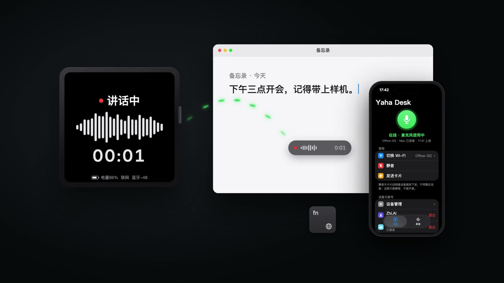

# Yaha Desk — Mac 开源离线语音输入与 AI 字幕

**Open-source offline voice typing and live AI captions for macOS. The microphone can be an iPhone or a ¥250 ESP32-S3 desk device with a hardware mute button.**

[](https://github.com/May-Yaha/yahamic/actions/workflows/ci.yml)
[](LICENSE)


**中文.** Yaha Desk 是 Mac 菜单栏 App,做两件事,语音识别都在本机完成(Qwen3-ASR + MLX,离线可用):

- **语音输入**:按住讲话键说话,松开出字,文字写进任意 App 的光标处(Codex、Claude Code、终端、微信、Electron/Flutter 应用),
  可以当 Mac 的离线听写、语音输入法用;可选 **AI 润色**(任意 OpenAI 兼容接口)。
- **AI 字幕**:直接采集 Mac 正在播放的声音(YouTube、B 站、网课、会议都行),本地转文字,
  Apple 系统离线翻译(或 AI 翻译)成中文,双语字幕贴在视频窗口下方。不需要任何硬件。

语音输入的麦克风有两种:**iPhone**(配套 App,锁屏也能讲),或一块约 ¥250 的乐鑫 **ESP32-S3 开发板**
(刷上固件就是带硬件静音键和触摸屏的**蓝牙无线麦克风**,也能当系统麦克风给 Zoom、FaceTime、QuickTime 用)。
登录百度网盘后,按住讲话和 AI 字幕的录音与文字都自动备份到你自己的网盘(字幕的备份可在面板关掉);
iPhone 上按天回放,并整理成 AI 工作总结。

产品名是 Yaha Desk;仓库名 yahamic 沿用自早期的 Wi-Fi 麦克风。产品定位与迭代路线见 [ROADMAP.md](ROADMAP.md)。

**English.** Yaha Desk is a macOS menu-bar app that does two things, with speech recognition running on-device
(Qwen3-ASR on Apple MLX, fully offline). **Voice typing**: hold a key, speak, release, and the text lands in the
focused input of any app (Codex, Claude Code, terminals, WeChat, Electron/Flutter apps), with optional **AI polish**
through any OpenAI-compatible API. **Live AI captions for any video**: the app captures the Mac's system audio
(YouTube, Bilibili, Zoom, local players; no virtual driver) through a Core Audio process tap, transcribes it with the
same model, translates it with Apple's on-device Translation (or your AI endpoint) and shows bilingual subtitles under
the video window; no hardware needed. The microphone for voice typing is an **iPhone** (companion app, works with the
screen locked) or an open-source **ESP32-S3 wireless Bluetooth (BLE) microphone**: the board streams 16 kHz Opus over
BLE GATT, has a hardware mute button and a 480×480 AMOLED touch screen that works as a desk dashboard, and shows up as
a system microphone through BlackHole for Zoom, FaceTime and QuickTime. Once you sign in, recordings and transcripts from both are backed up to
your own Baidu Pan and replayed on the iPhone with an AI daily summary. Firmware: ESP-IDF 6.1 + LVGL 9; Mac: Swift 6.2 /
SwiftUI, macOS 26; iPhone: iOS 26. Docs are mostly in Chinese; English issues and PRs are welcome.

## 从哪开始 / Get started

| 你手上有 | 能用什么 | 怎么开始 |
|---|---|---|
| 一台 Mac(Apple 芯片,macOS 26) | AI 字幕与翻译 | 到 [Releases](https://github.com/May-Yaha/yahamic/releases) 下载 DMG,菜单栏面板打开「视频字幕」;用法见[视频字幕](#6-视频实时字幕与翻译看外文视频出中文字幕) |
| Mac + iPhone(iOS 26) | 语音输入,手机当麦克风 | iPhone App 正在准备上架 App Store,目前用 Xcode 自行构建(见 [CONTRIBUTING.md](CONTRIBUTING.md));Mac 面板的声源选「手机」 |
| Mac + ESP32-S3 开发板 | 语音输入、硬件静音、桌面屏 | 按[快速开始](#快速开始--quick-start)装 Mac App、刷固件、蓝牙配对 |

Mac 目前还不能用自带麦克风做语音输入,这一项排在 [ROADMAP.md](ROADMAP.md) 的阶段 2。

## 演示 / Demo

[](docs/media/yahadesk-promo.mp4)

点图播放 60 秒演示([下载 mp4](https://github.com/May-Yaha/yahamic/raw/main/docs/media/yahadesk-promo.mp4)):
按住 Fn 说话、文字落在光标处,声音经加密蓝牙进 Mac,本地转文字与 AI 润色,iPhone 远程静音,设备屏通知,硬件静音。
画面按 0.5.1 的固件、Mac、iOS 界面重绘,通知文案与 Wi-Fi 名为示例。

**目录**:[从哪开始](#从哪开始--get-started) · [亮点](#亮点--features) · [视频字幕](#6-视频实时字幕与翻译看外文视频出中文字幕) · [硬件清单](#硬件清单--hardware) · [快速开始](#快速开始--quick-start) · [协议](docs/protocol.md) · [安全模型](#安全模型) · [使用速查](#使用速查) · [故障排查](#故障排查--troubleshooting) · [更多文档](#更多文档) · [参与贡献](#参与贡献)

## 亮点 / Features

**语音输入**

- **本地语音转文字**:Qwen3-ASR 0.6B 在 Apple Silicon 上实时出字幕,停顿处定稿,不上传语音。
- **写入任意 App**:辅助功能写入 / 键盘事件 / 剪贴板粘贴三条路自动选择,兼容终端、Electron(Codex)、Flutter(如流)、微信。
- **AI 润色(可选)**:去口头语、修标点,默认智谱 GLM,可换任意 OpenAI 兼容接口或本机模型服务。
- **手机当麦克风**:没有设备也能用,iPhone 经 PushToTalk 采集(锁屏可用)、经加密蓝牙传给 Mac,沿用 Mac 讲话键。
- **硬件静音**:板上按键一按,一比特音频都不会离开设备;BLE 全程 LE Secure Connections + MITM 配对。
- **系统麦克风**:经 BlackHole 虚拟声卡,会议、录音软件都能直接选它。

**AI 字幕**

- **视频实时字幕与翻译**:采集本机播放的声音(无需虚拟声卡),本地识别 + 系统离线翻译,中文大字主字幕、原文小字对照,贴在视频下方;一句讲完定稿再停留读完才换下一句,字号可调;看 YouTube 外文视频、网课、外语会议直接出中文字幕。
- **离线模型管理**:设置里一键下载 / 取消 / 删除 Qwen3-ASR 权重(断点续下),查看并下载字幕翻译用的系统语言包。

**录音与网盘备份**

- **按住讲话的录音**:登录百度网盘后,每段录音连同写入的文字自动备份到 `/apps/拾见/录音`;先存本机,上传成功才删,失败会补传。
- **AI 字幕的录音**:登录网盘后默认备份,字幕听到的声音和转写原文按段传到 `/apps/拾见/录音/视频字幕`;会议里对方的声音也会被录下,不想录就在面板关掉「备份到网盘」。
- **iPhone 回放与 AI 总结**:录音按天分组回放,当天的文字用你自己的 AI 接口整理成工作总结,待办可加入提醒事项。

**设备与实验功能**

- **桌面屏**:480×480 AMOLED 触摸屏显示时钟、Mac 负载、通知卡片;Mac App 内一键安装固件。
- **iPhone 远程管理设备**:看设备在线与静音状态、远程静音、发送卡片、切换 Wi-Fi。
- **实验功能**:豆包输入法模式、只留本人声音、训练集标注;Zhi.AI 工作台依赖作者运营的官方服务(见[云端与桌面工作台](#云端与桌面工作台)),自行构建的副本用不了。
- **可测试**:BLE 协议纯逻辑单测、固件 host 测试、本机控制接口自带端到端压测。

## 欢迎参与

适合上手的方向(详见 [CONTRIBUTING.md](CONTRIBUTING.md)):

- **更多硬件**:移植到其它 ESP32-S3 麦克风板(如 ESP32-S3-BOX、XIAO ESP32S3 Sense)。
- **更多语言与模型**:英文/多语种识别、Whisper 等其它 MLX 语音模型、热词。
- **兼容性**:更多 App 的文字写入适配,反馈哪个输入框写不进去也很有用。
- **音质**:24 kHz 档、降噪、回声消除。
- **文档**:英文文档、上手视频、外壳与 3D 打印。

关键词:ESP32 microphone, ESP32-S3 BLE audio, Bluetooth microphone, wireless mic for Mac, macOS dictation,
offline speech-to-text, voice typing, voice input, push-to-talk, Qwen3-ASR, MLX, Apple Silicon,
Opus, BlackHole virtual microphone, LVGL, ESP-IDF, AMOLED, SwiftUI menu bar app, iOS companion app,
live captions for Mac, real-time subtitles, YouTube subtitles translation, system audio capture, Core Audio process tap,
on-device translation, Apple Translation framework, bilingual subtitles, offline transcription。
ESP32 麦克风、蓝牙麦克风、无线麦克风、Mac 语音输入、离线语音转文字、语音听写、按住说话、语音输入法、
本地 ASR、AI 润色、虚拟麦克风、桌面屏、开源硬件、Mac 实时字幕、视频字幕翻译、YouTube 中文字幕、
同声传译字幕、外语视频翻译、网课字幕、会议实时字幕、系统内录、双语字幕、离线翻译。

## 项目背景

本仓由 yahamic 的早期 Wi-Fi 麦克风演进而来。设备仍是 Mac mini 的无线麦克风，
空闲时是桌面工作台：触摸屏首页沿用雅哈麦克风的时钟与 CPU/内存/鼠标/键盘四环，agent 消息以通知卡片弹出；首页「息屏」卡关掉屏幕省电，触摸任意处唤醒；
连了 Zhi.AI 时首页多一行入口，进入任务、采集、处理、GLM、小程序的健康总览，点行看详情，新告警自动弹出告警页。
音频走 BLE，设备通过 Wi-Fi 直接同步云端。

一块约 ¥250 的 [Waveshare ESP32-S3-Touch-AMOLED-2.16](https://www.waveshare.com/ESP32-S3-Touch-AMOLED-2.16)
开发板,刷上本仓库的固件,就变成 Mac mini 的**无线麦克风**:开机就用蓝牙(BLE)广播,
Mac 上的 Yaha Desk App 自动连上,Mac 上多出一个叫 "BlackHole 2ch" 的麦克风输入,任何
应用(备忘录听写、Zoom、FaceTime、QuickTime……)都能选它。音频不用配网，云端内容需要 Wi-Fi；首次连接按设备
屏幕上的 6 位数字在 Mac 上配对一次即可。板上按键是**硬件静音**:按下后不再送声,
一比特音频都不会离开设备。

硬件用的是[乐鑫(Espressif)](https://www.espressif.com/) ESP32-S3R8 芯片,板子是[微雪(Waveshare)](https://www.waveshare.com/)
的现成开发板;固件基于乐鑫 ESP-IDF 与乐鑫组件库(Opus 编解码、codec、屏幕与触摸驱动、LVGL 移植、MQTT)。
其中 `esp_audio_codec` 的许可只允许用在乐鑫芯片上。

工程基于开源项目 [OpenCharm](https://github.com/opencharm-labs/opencharm)(给 AI
代理做"身体"的开源硬件项目,同样使用这块板子):板级驱动与构建配置继承自它;
音频链路按"纯麦克风"重新设计。感谢乐鑫、微雪、OpenCharm 与
xiaozhi-esp32(组件与许可见 [LICENSES/THIRD_PARTY_NOTICES.md](LICENSES/THIRD_PARTY_NOTICES.md))。

```
┌─────────────────────────┐   BLE GATT(加密)     ┌──────────────────────────┐
│  设备(ESP32-S3 板)      │  16 kHz Opus notify  │  Mac                     │
│                         │ ───────────────────▶ │                          │
│  ES7210 麦克风           │   60 ms 帧,按 MTU 分片 │  Yaha Desk(菜单栏 App)  │
│  按键:短按静音           │   + 静音状态          │   │ 解码、预缓冲、重采样    │
│  屏幕:配对数字 / 讲话中 │ ◀─────────────────── │   ▼                      │
│                         │   静音指令 / 仪表盘    │  BlackHole(虚拟麦克风)   │
└─────────────────────────┘                       │   ▲                      │
   发现:设备广播 yahadesk service UUID              │  任何应用选它当麦克风输入  │
                                                   └──────────────────────────┘
```

## 硬件清单 / Hardware

| 物品 | 说明 | 参考价 |
|---|---|---|
| Waveshare ESP32-S3-Touch-AMOLED-2.16 | 与 OpenCharm 相同的参考板:ESP32-S3R8(8 MB PSRAM / 16 MB flash)、ES7210 双麦克风、ES8311 扬声器、480×480 方屏、按键 | 约 ¥230 |
| USB-C 数据线 | 供电 + 刷机(板上的 USB 口就是 ESP32-S3 自带的 USB-Serial/JTAG,日志也从这里出) | — |
| (可选)3.7 V 锂电池 | 板载 MX1.25 电池接口 + AXP2101 电源管理,屏幕会显示电量 | — |

不需要扬声器、不需要外壳也能用(不过 OpenCharm 的 [3D 打印外壳](https://github.com/opencharm-labs/opencharm)
可以直接复用)。

## 目录结构

```
yahamic/
├── firmware/                 # ESP32-S3 固件(ESP-IDF 6.1)
│   ├── main/
│   │   ├── main.cpp          # 30 Hz 主循环:按键(静音)、屏幕、状态日志
│   │   ├── audio.{h,cpp}     # ES7210 采集,16 kHz 单声道,60 ms Opus 帧(CBR)
│   │   ├── uplink.{h,cpp}    # BLE GATT 外设(NimBLE):广播、配对、audio 分片 notify、静音/仪表盘
│   │   ├── cloud.{h,cpp}     # Wi-Fi、HTTPS/OAuth、云端配置与通知
│   │   ├── display.h         # 无I/O的工作台导航与通知状态，用host C++测试
│   │   ├── mic_state.{h,cpp} # 静音唯一入口(按键 / Mac 遥控 / 断链)
│   │   ├── board*.{h,cpp}    # CO5300 屏幕、CST9220 触摸、LVGL 渲染、按键、I2C
│   │   ├── power.{h,cpp}     # AXP2101 电量读数 + 打开麦克风供电
│   │   └── generated/fonts/  # 屏幕中文字体子集(tools/make_fonts.sh 生成)
│   ├── sdkconfig.defaults / partitions.csv / CMakeLists.txt
│   └── main/Kconfig.projbuild          # CONFIG_YAHADESK_SELFTEST(台架自检)
├── apps/                     # 各端应用(以后的 Android 也放这里)
│   ├── shared/               # macOS 与 iOS 共用的 Swift 包
│   │   ├── Sources/DeskProtocol/  # 纯逻辑:GATT UUID、audio 分片重组、写入载荷、key value 行(可单测)
│   │   └── Sources/DeskShared/    # 网盘登录/文件、DMS、云端授权、录音回放与 AI 整理
│   ├── macos/                # Yaha Desk 菜单栏 App(Swift 6.2+,macOS 26)
│   │   ├── Sources/COpus/    # libopus 的系统库模块
│   │   ├── Sources/DeskCore/ # Link(CoreBluetooth 链路/Opus)、Audio、Input(Fn)、Flash、Metrics
│   │   ├── Sources/YahaDesk/ # 菜单栏 App:App / Model / Services(控制接口、云端同步、BlackHole 安装)/ Views
│   │   ├── Tests/            # DeskProtocolTests、YahaDeskTests
│   │   └── scripts/          # 打包(make-app.sh、make-icon.swift)与语音识别评测(asr_cer.py、audio_quality*)
│   └── ios/                  # iPhone App(SwiftUI,iOS 26):设备状态、远程静音、手机当麦克风、录音回放;project.yml 由 XcodeGen 生成工程
├── test/                     # demo 与可行性验证(不进产品与 CI),见 test/README.md
├── agent/                    # yahamic-agent 编码工作流与技能
├── docs/
│   ├── architecture.md       # 模块图、依赖方向、协议 v3 时序
│   ├── cloud-contract.md  domain-glossary.md
│   ├── requirements/         # 近两天的需求与验收记录
│   ├── archive/              # 归档:更早的需求(requirements/)与报告、审计、迁移记录(reports/)
│   └── media/
└── LICENSES/THIRD_PARTY_NOTICES.md
```

## 快速开始 / Quick Start

### 1. Mac 端:Yaha Desk 菜单栏 App

需要 macOS 26 与 Xcode 26(Swift 6.2+),以及 libopus(`brew install opus`)。

```bash
# 打包并安装 Yaha Desk(菜单栏 App,无 Dock 图标)
cd apps/macos && ./scripts/make-app.sh --install
```

不想自己构建:到 GitHub Releases 下载 Developer ID 签名并公证的 zip(`./scripts/make-app.sh devid` 产出)。
线下分发可用 `./scripts/make-app.sh --dmg`(开发证书签名、未公证,首次打开需在 系统设置 → 隐私与安全性 里放行)。
不上架 Mac App Store:按住讲话要全局监听键盘、经辅助功能写入其他 App 的输入框,沙盒里做不到。

首次启动系统会问是否允许 Yaha Desk 使用蓝牙,选允许(之后在 系统设置 → 隐私与安全性
→ 蓝牙 里管理)。

虚拟麦克风用 BlackHole 2ch(把它想成"一根环回音频线")。没装时面板会出现
「安装 BlackHole」卡片:**一键安装**直接下载官方 pkg(校验 sha256)并弹管理员授权,
不需要 Homebrew;也可以复制终端命令自己装(有 Homebrew 时是
`brew install blackhole-2ch`)。装完若 CoreAudio 里看不到:`sudo killall coreaudiod`。

顶栏的桌面设备图标是控制中心入口，送声时显示红色；设备连接与静音状态在控制面板中查看。
按住讲话键时鼠标指针下方出现一个玻璃胶囊(不抢焦点,字幕和修改框接在胶囊下面):灰点「连接麦克风…」→ 红点 + 实时电平条
+ 计时;设备不在线时显示「设备未连接」。松开 0.3 秒后消失。
点开是控制面板,从上到下按任务排:麦克风卡片(「设备 / 手机」声源切换、状态、电平、蓝牙信号、开麦/静音)→
「讲话」(按住讲话开关,打开后选讲话键)→「转文字」(关 / 本地,装了豆包输入法时多一个「豆包」;选「本地」才出现二次确认与 AI 润色)→「视频字幕」→
「输出」(输出设备)→「实验功能」(只留本人声音)→ 设备联网与授权入口 → 日志（可一键清理）、**开机自启**、退出。右上角齿轮打开设备设置窗口,
侧栏按 设备 / 语音 / 云与数据 / 实验功能 分组。首次使用系统会弹「辅助功能」授权(监听 Fn 要用),
到 系统设置 → 隐私与安全性 → 辅助功能 勾选 Yaha Desk 即可。日志在
`~/Library/Logs/YahaDesk.log`。

> 麦克风状态由 `apps/macos/Sources/YahaDesk/Model/HomeDevice.swift` 中的 `MicDevice` 描述，
> 设备链路、音频出口与 Fn 监听在 `DeskCore` 库里。

### 2. 固件构建与刷写

需要 [ESP-IDF 6.1](https://docs.espressif.com/projects/esp-idf/zh_CN/latest/esp32s3/get-started/index.html):

```bash
cd firmware
idf.py set-target esp32s3     # 首次
idf.py build
idf.py flash monitor          # 板子接 USB-C;Ctrl+] 退出日志
```

0.3.0 用桌面工作台替代轮播。请先更新服务端，再构建 Mac 与固件；构建不等于上传，
Agent 不会在未获本次授权时执行烧录。不要为升级删除设备 NVS 或蓝牙配对数据。

台架自检(不连 Mac,采 1 秒打印响度,确认麦克风链路):
`idf.py menuconfig` → YahaDesk → 开启 `开机自检`,重新刷写。

网盘绑定需要出厂身份分区 `fac`(`0x410000`,与 `nvs` 分开)。开发板用实验室出厂 CA 在本机生成,
输出放仓库外,只打印设备号与证书指纹;烧录同样需要单独授权:

```bash
~/.espressif/python_env/idf6.1_py3.14_env/bin/python -I tools/factory_identity.py
esptool.py --chip esp32s3 write_flash 0x410000 ~/.local/share/yahadesk/factory/<设备号>/fac.bin
```

没有 `fac` 分区的设备照常当麦克风用,Mac 绑定网盘时提示「设备没有出厂身份」。

### 3. 蓝牙配对(只用一次)

1. 设备上电即广播 `yahadesk-XXXX`(XXXX 为蓝牙 MAC 后两字节),Yaha Desk 发现后自动连接。
2. 首次连接时设备屏幕变橙,显示 `PAIR`、6 位数字和 `ENTER ON MAC`;Mac 弹出系统配对框,输入这 6 位数。
3. 配对完成后屏幕转为静音待命。配对信息两端都会记住(设备存 NVS),以后开机自动重连。

换 Mac 或设备重刷过 NVS 后连不上:在 系统设置 → 蓝牙 里对 yahadesk「忽略此设备」,再重连一次走配对。

设备最多记 8 台主机的配对(家里、公司两台 Mac 加 iPhone 够用)。2026-11-07 之前构建的固件只记 3 个、CCCD 只存 8 个,
存满会删最旧的配对:带到另一处时 Mac 日志报 `Peer removed pairing information`,菜单栏面板提示去系统蓝牙设置移除
yahadesk,再点「重新连接」按屏幕数字配对。

### 4. 用起来

- 设备屏幕红点「讲话中」= 正在送声。打开 系统设置 → 声音 → 输入,选
  **BlackHole 2ch**;或在 Zoom/QuickTime 等应用里选它。
- **短按按键**:硬件静音(屏幕灰点「已静音」,不再送声),再按恢复。静音后先发送约 240 ms
  渐弱话尾,随后关闭 codec;下次开麦会丢弃一帧上电瞬态,开头需预留约 0.1 秒。
- **讲话键松开**:Mac 晚 0.3 秒才让设备静音,最后一个字不会被截掉;本地转文字等话尾帧到齐、播完再定稿。
- 屏幕底部常显:电量和蓝牙信号(`BLE -55DB`);未连接时显示 `ADV`(广播中)。
- 走出蓝牙范围或 Mac 关蓝牙时设备自动静音,回来后自动重连。

### 5. 在 Codex 里语音输入

语音转文字由 Yaha Desk 在本机完成，不需要豆包、微信等第三方输入法。「本地转文字」新装默认打开，
首次会从 Hugging Face 下载约 830 MB 的 `mlx-community/Qwen3-ASR-0.6B-6bit`（固定提交，MLX 推理，
缓存在 `~/Library/Application Support/YahaDesk/Models/`）。模型准备完成后，点进任意输入框，按住 Fn 讲话；按住满 1 秒浮层出现并实时显示字幕，不到 1 秒松开当误触忽略。
字幕边说边刷新，前面的话在停顿处定稿、不再重算。
松开后默认直接写入光标处；面板里打开「二次确认」后，定稿停在浮层里等你改，改完回车写入、Esc 放弃。
可选「AI 润色」：在设备设置 →「AI 润色」填自己的 API Key（只存本机钥匙串），再打开面板里的「AI 润色」，
定稿会先发给大模型去掉口头语、修标点再写入，浮层胶囊显示「AI 润色中」动效（开了二次确认就在浮层里改润色后的文字）；失败或 10 秒超时写入原文。
默认接智谱 GLM Coding Plan（`glm-5.3-flash`）；接口地址、模型和提示词都可在设置里改，任何 OpenAI 兼容的 Chat Completions 接口都行（只发 https，本机服务可用 `http://localhost`）。
打开后转写文字会上传到所填接口；随录音备份的 `.txt` 标注仍存润色前的原文（人工改过则存改后的）。
不开放辅助功能写入的终端等应用按键盘输入打字；微信 4.x 这类拿不到输入框的 App 经剪贴板 ⌘V 粘贴（半秒后还原剪贴板，松开前切走了就不贴）；如流等 Flutter 应用、Codex 等 Electron 应用的辅助功能写入只改无障碍树、输入框里没有字，同样走粘贴，键盘事件带 HID 事件源（Flutter 丢弃无来源的合成事件）；都不自动发送；登录网盘后，写入的（含人工改过的）文本会以同名 `.txt` 随录音一起备份到 `/apps/拾见/录音`。转写在本机完成，后续可离线使用；BlackHole
仍同时供会议、录音等应用使用。打开本地转文字会自动打开「按住讲话」，关闭后者也会关闭
本地转文字。输入法里的语音快捷键应关闭或改成别的键，避免它抢 Fn。

想用豆包输入法自己的语音识别时（实验功能，本机装了豆包输入法才有这一项），在面板「转文字」选「豆包」：Yaha Desk 只送声到 BlackHole、不弹浮层，
并自动把系统输入法切到豆包（装了但没加进输入法列表的也会先加上）；按讲话键时若输入法被切走，会自动切回豆包。
豆包按系统默认输入录音，所以豆包模式会把系统默认输入设成 BlackHole（否则它听的是 Mac 或耳机麦克风，开头还会因蓝牙耳机切换丢字）。
豆包自己也监听讲话键、一松开就停录，而话尾这时还在设备淡出与 Mac 缓冲里：Yaha Desk 先扣住松开事件，
等话尾播进 BlackHole 再交给系统（最多扣 3 秒）；扣住期间按别的键会先补发松开。

如果关闭「本地转文字」，仍可沿用系统听写：

Codex(桌面 App 的输入框或终端里的 CLI)不需要额外插件:用 macOS 自带听写,把听写的麦克风换成 BlackHole,
说话经设备 → Yaha Desk → BlackHole → 听写,文字直接打进当前光标所在的输入框。

1. 系统设置 → 键盘 → 听写:打开听写;语言加「中文(普通话)」。
2. 同一页「麦克风来源」选 **BlackHole 2ch**(不选的话听写用的是 Mac 自带麦克风)。
3. 「快捷键」改成「按两下 Control」:Fn 留给 Yaha Desk 的「按住 Fn 讲话」,两者不抢同一个键。
4. 用法:点进 Codex 输入框 → 按两下 Control 开始听写 → 按住 Fn(或在面板里开麦)说话 → 松开 Fn,
   再按两下 Control 结束听写,检查文字后回车发送。

听写只出文字,不会自动回车;设备静音或未连接时 BlackHole 没有声音,听写会停在空白。
以上系统听写步骤按 macOS 的公开设置整理,本机未逐项实测。

### 6. 视频实时字幕与翻译(看外文视频出中文字幕)

不需要 ESP32 设备,也不需要 BlackHole。Yaha Desk 用 macOS 14.2+ 的 Core Audio 进程 tap 直接采集**本机正在播放的声音**,
所以浏览器里的 YouTube、B 站,本地播放器、网课、Zoom/腾讯会议对方的声音都能出字幕。

1. 菜单栏面板 →「视频字幕」打开。首次会弹「录制系统音频」授权,在 系统设置 → 隐私与安全性 → 屏幕与系统录音 → 仅系统录音 里允许 Yaha Desk。
2. 想要翻译就打开「翻译」,选译成简体中文 / 英语 / 日语 / 韩语。
3. 「字幕大小」滑块调字号(14–44 pt,默认 22),浮层高宽跟着变,设置会记住。
4. 播放视频:字幕浮层贴在前台 App 最大窗口的下方。有译文时译文是大字主字幕,原文小字一行对照;没有下文时读完再停 4 秒收起。

工作方式:系统声音 → 16 kHz → 本地 Qwen3-ASR(与「本地转文字」共用同一个模型,声音不出本机)→ 去掉 um/uh、分句定稿 →
翻译。原文语言在中、英、日、韩、法、德、西、俄里自动判断,和目标语言相同时不翻。

**一句一停,减少跳动**:一句话识别完整就定下来,之后不再改;每屏停 1–3 秒(字多停得久),读完才换下一句。
停顿 0.8 秒当这句讲完;超过两行的长句在逗号或 and/but/so 等连词前先出一截。识别落后时每屏只停 1.2 秒,放得下的几句并成一屏追上进度。
不翻译时显示正在讲的半句(同一句里新字走打字动效,换句整屏淡入);翻译时只上整句。
用 32 分钟英文演讲按实时节奏回放测试:开头 180 秒 75 屏、无重复句(改前 106 屏、同一句连出五六次)。

**网盘备份**(默认开,登录网盘后生效;面板「视频字幕」下的「备份到网盘」可关):字幕听到的声音按一段话(静音 2 秒为界,连续播放每 10 分钟切一段)编成 Opus,
连同这段的转写原文一起传到 `/apps/拾见/录音/视频字幕/<日期>/`;不到 1 秒的不留。会议里对方的声音也会被录下,不想录就关掉。

翻译优先用 **Apple 系统离线翻译**(免费、离线);某个语言对没装语言包、但在设置里填了 AI Key 时,改用同一个 OpenAI 兼容接口翻译(会上传字幕文字)。

**离线模型**:设备设置 → 语音 →「离线模型」:

- **Qwen3-ASR 0.6B**:状态与占用(约 820 MB),下载带进度、可取消、中断后接着下;在访达中显示;删除(本地转文字或视频字幕开着时不让删)。
- **字幕翻译语言包**:列出每个原文语言 → 目标语言,显示已安装 / 可下载 / 不支持;点「下载」由系统弹框确认,关掉弹框也会在后台继续下,装好后本页自动变「已安装」,字幕立即改走离线翻译。语言包由系统管,删除在 系统设置 → 通用 → 语言与地区 → 翻译语言。

限制:字幕比声音晚约 1–2 秒;按住讲话转文字时字幕会晚一拍(两者串行用同一个模型);画中画、多显示器全屏未专门适配。
设计与选型(为什么不用豆包输入法、BlackHole、Whisper)见 [docs/archive/requirements/desk-live-caption-2026-11-12](docs/archive/requirements/desk-live-caption-2026-11-12/README.md)。

## 云端与桌面工作台

> **云端依赖说明**:工作台总览/告警、设备授权与网盘录音备份依赖作者运营的官方服务 `hub.flyaha.top`
> 与百度网盘开放平台。地址写在 `firmware/main/cloud.cpp`、`apps/shared/Sources/DeskShared/CloudClient.swift`、
> `apps/shared/Sources/DeskShared/PanLogin.swift`;服务端暂不开源,也不支持自建,自行构建的副本连不上这部分功能。
> 不依赖它的部分照常可用:BLE 麦克风、BlackHole 输入、按住讲话、本地转文字(模型下载后可离线)、
> AI 润色(自填 Key 与接口)、本机控制接口。设备未授权时首页只是不显示工作台入口。

授权流程、工作台界面与远程控制的细节见 [docs/workbench.md](docs/workbench.md)。

## 安全模型

链路安全全部交给蓝牙控制器:LE Secure Connections(ECDH P-256)+ MITM 认证 + bonding。

- **全部特征要求加密且已认证**(`READ/WRITE/NOTIFY_*_ENC | *_AUTHEN`)。未配对的 central
  (例如别人的手机)能看到广播,但读不到 info/status、订阅不了 audio、写不进静音和仪表盘。
- **配对用 passkey entry**:设备 IO 能力为 DisplayOnly,每次配对随机生成 6 位数只显示在
  屏幕上(不进日志),Mac 输入后完成认证,防止中间人;
  要配对就得看得到设备屏幕。关掉了 legacy pairing。
- 如果加密完成但没有 MITM 认证(对端用 Just Works),设备立即断开。
- bond 密钥设备存 NVS、Mac 存系统钥匙串;Mac 删掉配对后再连,设备删旧 bond 重新配对。
- 本机控制接口只对当前用户开放(见 [docs/control-interface.md](docs/control-interface.md))。

## 使用速查

- **按住讲话键**:讲话(设备屏幕红点「讲话中」+ 居中电平条 + 计时);松开:静音(灰点「已静音」)
- 讲话动效可选:`idf.py menuconfig` → YahaDesk → 「讲话时的屏幕动效」,电平条 + 计时(默认)
  或正弦声波;电平条显示高出房间底噪的部分,安静时收成一排小圆点
- **空闲**:桌面工作台（健康总览、告警、通知），触摸点击操作；Mac离线不阻断设备Wi-Fi展示
- **设备短按按键**:同样的静音开关
- 屏幕底部:电量与蓝牙信号;配对屏:6 位配对数字

## 故障排查 / Troubleshooting

| 症状 | 处置 |
|---|---|
| 屏幕一直 `寻找 Mac 中`,底部 `ADV` | Yaha Desk 在运行吗?系统设置 → 隐私与安全性 → 蓝牙 里允许了吗?Mac 蓝牙开着吗?靠近一些 |
| App 日志「蓝牙权限」警告 | 系统设置 → 隐私与安全性 → 蓝牙,打开 Yaha Desk |
| 一直不出配对框 / 日志「读取失败」「订阅失败」 | 设备重刷过或 Mac 换过:系统设置 → 蓝牙 里忽略 yahadesk,再等它重连配对 |
| 刷了新固件，App 仍按旧固件显示（如没有 Wi-Fi 扫描） | 已配对的 Mac 会缓存设备的特征表。固件每次启动发 Service Changed，App 收到后自动重连刷新；仍不行就在系统设置 → 蓝牙里忽略 yahadesk 后重连配对 |
| 屏幕停在橙色配对数字 | Mac 上的系统配对框被关掉了:断电重启设备再配一次 |
| 应用里没有 BlackHole 2ch | 面板「安装 BlackHole」一键安装,或 `brew install blackhole-2ch`;仍看不到就 `sudo killall coreaudiod` |
| 打开视频字幕后日志「系统声音采集启动失败」 | 系统设置 → 隐私与安全性 → 屏幕与系统录音 → 仅系统录音,打开 Yaha Desk 后再开一次「视频字幕」 |
| 视频字幕只有原文、没有译文 | 设备设置 →「离线模型」下载对应语言包,或在「AI 润色」里填 API Key;日志会提示缺哪个语言对 |
| 声音卡顿 | 靠近 Mac、避开金属遮挡;控制接口 `status` 看 `rssi` 与 `droppedFrames`,`stress 60` 复现 |

## 更多文档

| 文档 | 内容 |
|---|---|
| [ROADMAP.md](ROADMAP.md) | 产品定位、功能分层、迭代阶段、iOS 上架计划 |
| [docs/protocol.md](docs/protocol.md) | BLE 协议 v3:特征表、音频分片、手机当麦克风;为什么不走系统蓝牙麦克风 |
| [docs/architecture.md](docs/architecture.md) | 模块图、依赖方向、时序 |
| [docs/workbench.md](docs/workbench.md) | 云端授权流程、桌面工作台界面、设备屏幕的中文字体 |
| [docs/control-interface.md](docs/control-interface.md) | 本机控制接口(control.sock):状态、压测、远程排障 |
| [docs/performance.md](docs/performance.md) | 压测结论与渲染性能账本 |
| [docs/verification.md](docs/verification.md) | 已验证 / 未验证清单,联调踩过的坑 |
| [docs/archive/requirements](docs/archive/requirements/README.md) | 历次需求与验收记录 |

## 许可证

本仓自有源码以 GNU GPL v3 开源(见 [LICENSE](LICENSE))。第三方组件(乐鑫 ESP-IDF 与组件、LVGL、
Noto Sans CJK、BlackHole 等)见 [LICENSES/THIRD_PARTY_NOTICES.md](LICENSES/THIRD_PARTY_NOTICES.md)。
本项目与 OpenCharm、Waveshare(微雪)、Espressif(乐鑫)、Apple 无隶属关系;ESP32、ESP-IDF 是乐鑫的商标。

## 参与贡献

见 [CONTRIBUTING.md](CONTRIBUTING.md);安全问题按 [SECURITY.md](SECURITY.md) 私下报告。

仓库里的 `AGENTS.md`、`CLAUDE.md`、`.claude/`、`.zcode/`、`.mcp.json` 与 `agent/` 是作者用 AI 编码助手开发时的
约定与工具(编码图工作流、技能说明),不参与 App 和固件构建,不用 AI 助手可以忽略。
