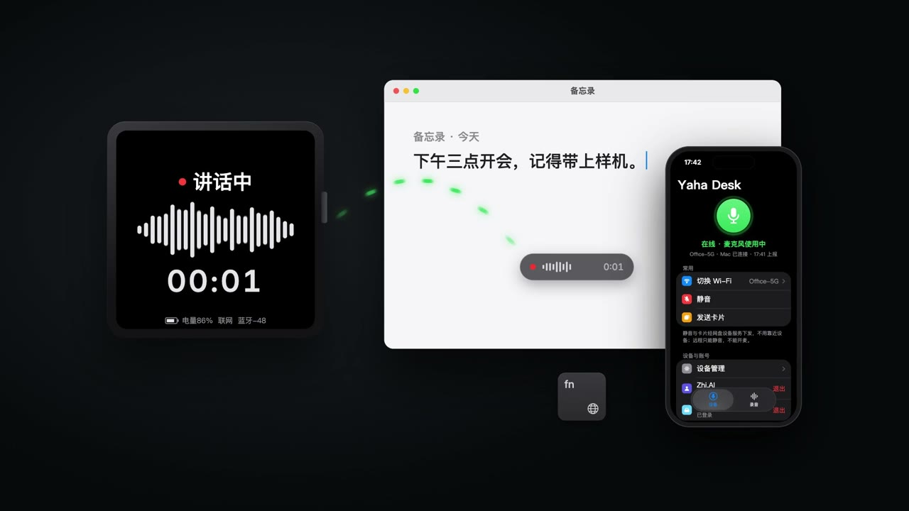

# Yaha Desk — ESP32-S3 蓝牙无线麦克风 + Mac 离线语音输入

**Open-source ESP32-S3 BLE wireless microphone and offline push-to-talk voice typing for macOS, with an iPhone companion app.**

[](https://github.com/May-Yaha/yahamic/actions/workflows/ci.yml)
[](LICENSE)


**English.** An open-source **ESP32-S3 wireless Bluetooth (BLE) microphone for macOS**, plus a menu-bar app with
**push-to-talk local speech-to-text** (Qwen3-ASR on Apple MLX, fully offline) and optional **AI polish** through any
OpenAI-compatible API. Hold a key, speak, release: the text lands in the focused input of any app (Codex, Claude Code,
terminals, WeChat, Electron/Flutter apps). The board streams 16 kHz Opus over BLE GATT; the Mac exposes it as a
system microphone through BlackHole, so Zoom, FaceTime and QuickTime can use it too. When idle, the 480×480 AMOLED
touch screen is a desk dashboard (clock, CPU/memory rings, notifications). Firmware: ESP-IDF 6.1 + LVGL 9;
Mac: Swift 6.2 / SwiftUI, macOS 26. An iPhone app (iOS 26) shows the device status, mutes it remotely and plays back
recordings. **Live captions for any video**: the app captures the Mac's system audio (YouTube, Bilibili, Zoom,
local players; no virtual driver) through a Core Audio process tap, transcribes it offline with the same Qwen3-ASR
model, translates it with Apple's on-device Translation (or your AI endpoint) and shows bilingual subtitles under
the video window. Docs are mostly in Chinese; English issues and PRs are welcome.

**中文.** 一块约 ¥250 的乐鑫 ESP32-S3 开发板,刷上固件就是 Mac 的**蓝牙无线麦克风**;配套菜单栏 App 提供
**按住说话、松开出字**的本地语音输入(Qwen3-ASR + MLX,离线可用)和可选的 **AI 润色**(任意 OpenAI 兼容接口)。
文字直接写进任意 App 的光标处,可以当 Mac 的离线听写、语音输入法用;也能当系统麦克风给 Zoom、FaceTime、QuickTime 用。
配套 iPhone App 查看设备状态、远程静音、回放录音。
**视频实时字幕与翻译**:不用设备也能用,直接采集 Mac 正在播放的声音(YouTube、B 站、网课、会议都行),
本地 Qwen3-ASR 转文字,Apple 系统离线翻译(或 AI 翻译)成中文,双语字幕贴在视频窗口下方。

## 演示 / Demo

[](docs/media/yahadesk-promo.mp4)

点图播放 60 秒演示([下载 mp4](https://github.com/May-Yaha/yahamic/raw/main/docs/media/yahadesk-promo.mp4)):
按住 Fn 说话、文字落在光标处,声音经加密蓝牙进 Mac,本地转文字与 AI 润色,iPhone 远程静音,设备屏通知,硬件静音。
画面按 0.5.1 的固件、Mac、iOS 界面重绘,通知文案与 Wi-Fi 名为示例。

**目录**:[亮点](#亮点--features) · [视频字幕](#6-视频实时字幕与翻译看外文视频出中文字幕) · [硬件清单](#硬件清单--hardware) · [快速开始](#快速开始--quick-start) · [协议](#协议-v3设备--macble-gatt) · [安全模型](#安全模型) · [使用速查](#使用速查) · [故障排查](#故障排查--troubleshooting) · [参与贡献](#参与贡献)

## 亮点 / Features

- **硬件静音**:板上按键一按,一比特音频都不会离开设备;BLE 全程 LE Secure Connections + MITM 配对。
- **本地语音转文字**:Qwen3-ASR 0.6B 在 Apple Silicon 上实时出字幕,停顿处定稿,不上传语音。
- **写入任意 App**:辅助功能写入 / 键盘事件 / 剪贴板粘贴三条路自动选择,兼容终端、Electron(Codex)、Flutter(如流)、微信。
- **视频实时字幕与翻译**:采集本机播放的声音(无需虚拟声卡),本地识别 + 系统离线翻译,中文大字主字幕、原文小字对照,贴在视频下方;看 YouTube 外文视频、网课、外语会议直接出中文字幕。
- **离线模型管理**:设置里一键下载 / 取消 / 删除 Qwen3-ASR 权重(断点续下),查看并下载字幕翻译用的系统语言包。
- **AI 润色(可选)**:去口头语、修标点,默认智谱 GLM,可换任意 OpenAI 兼容接口或本机模型服务。
- **系统麦克风**:经 BlackHole 虚拟声卡,会议、录音软件都能直接选它。
- **桌面工作台**:480×480 AMOLED 触摸屏显示时钟、Mac 负载、通知卡片。
- **iPhone App**:看设备在线与静音状态、远程静音、发送卡片,录音按天分组回放。
- **手机当麦克风**:没有设备也能用,iPhone 经 PushToTalk 采集(锁屏可用)、经加密蓝牙传给 Mac,沿用 Mac 讲话键。
- **可测试**:BLE 协议纯逻辑单测、固件 host 测试、本机控制接口自带端到端压测。

## 欢迎参与

适合上手的方向(详见 [CONTRIBUTING.md](CONTRIBUTING.md)):

- **更多硬件**:移植到其它 ESP32-S3 麦克风板(如 ESP32-S3-BOX、XIAO ESP32S3 Sense)。
- **更多语言与模型**:英文/多语种识别、Whisper 等其它 MLX 语音模型、热词。
- **兼容性**:更多 App 的文字写入适配,反馈哪个输入框写不进去也很有用。
- **音质**:24 kHz 档、降噪、回声消除。
- **文档**:英文文档、上手视频、外壳与 3D 打印。

关键词:ESP32 microphone, ESP32-S3 BLE audio, Bluetooth microphone, wireless mic for Mac, macOS dictation,
offline speech-to-text, voice typing, voice input, push-to-talk, Qwen3-ASR, MLX, Apple Silicon,
Opus, BlackHole virtual microphone, LVGL, ESP-IDF, AMOLED, SwiftUI menu bar app, iOS companion app,
live captions for Mac, real-time subtitles, YouTube subtitles translation, system audio capture, Core Audio process tap,
on-device translation, Apple Translation framework, bilingual subtitles, offline transcription。
ESP32 麦克风、蓝牙麦克风、无线麦克风、Mac 语音输入、离线语音转文字、语音听写、按住说话、语音输入法、
本地 ASR、AI 润色、虚拟麦克风、桌面屏、开源硬件、Mac 实时字幕、视频字幕翻译、YouTube 中文字幕、
同声传译字幕、外语视频翻译、网课字幕、会议实时字幕、系统内录、双语字幕、离线翻译。

## 项目背景

本仓由 yahamic 的早期 Wi-Fi 麦克风演进而来。设备仍是 Mac mini 的无线麦克风，
空闲时是桌面工作台：触摸屏首页沿用雅哈麦克风的时钟与 CPU/内存/鼠标/键盘四环，agent 消息以通知卡片弹出；首页「息屏」卡关掉屏幕省电，触摸任意处唤醒；
连了 Zhi.AI 时首页多一行入口，进入任务、采集、处理、GLM、小程序的健康总览，点行看详情，新告警自动弹出告警页。
音频走 BLE，设备通过 Wi-Fi 直接同步云端。

一块约 ¥250 的 [Waveshare ESP32-S3-Touch-AMOLED-2.16](https://www.waveshare.com/ESP32-S3-Touch-AMOLED-2.16)
开发板,刷上本仓库的固件,就变成 Mac mini 的**无线麦克风**:开机就用蓝牙(BLE)广播,
Mac 上的 Yaha Desk App 自动连上,Mac 上多出一个叫 "BlackHole 2ch" 的麦克风输入,任何
应用(备忘录听写、Zoom、FaceTime、QuickTime……)都能选它。音频不用配网，云端内容需要 Wi-Fi；首次连接按设备
屏幕上的 6 位数字在 Mac 上配对一次即可。板上按键是**硬件静音**:按下后不再送声,
一比特音频都不会离开设备。

硬件用的是[乐鑫(Espressif)](https://www.espressif.com/) ESP32-S3R8 芯片,板子是[微雪(Waveshare)](https://www.waveshare.com/)
的现成开发板;固件基于乐鑫 ESP-IDF 与乐鑫组件库(Opus 编解码、codec、屏幕与触摸驱动、LVGL 移植、MQTT)。
其中 `esp_audio_codec` 的许可只允许用在乐鑫芯片上。

工程基于开源项目 [OpenCharm](https://github.com/opencharm-labs/opencharm)(给 AI
代理做"身体"的开源硬件项目,同样使用这块板子):板级驱动与构建配置继承自它;
音频链路按"纯麦克风"重新设计。感谢乐鑫、微雪、OpenCharm 与
xiaozhi-esp32(组件与许可见 [LICENSES/THIRD_PARTY_NOTICES.md](LICENSES/THIRD_PARTY_NOTICES.md))。

```
┌─────────────────────────┐   BLE GATT(加密)     ┌──────────────────────────┐
│  设备(ESP32-S3 板)      │  16 kHz Opus notify  │  Mac                     │
│                         │ ───────────────────▶ │                          │
│  ES7210 麦克风           │   60 ms 帧,按 MTU 分片 │  Yaha Desk(菜单栏 App)  │
│  按键:短按静音           │   + 静音状态          │   │ 解码、预缓冲、重采样    │
│  屏幕:配对数字 / 讲话中 │ ◀─────────────────── │   ▼                      │
│                         │   静音指令 / 仪表盘    │  BlackHole(虚拟麦克风)   │
└─────────────────────────┘                       │   ▲                      │
   发现:设备广播 yahadesk service UUID              │  任何应用选它当麦克风输入  │
                                                   └──────────────────────────┘
```

## 为什么是 App 自己连 BLE,而不是系统蓝牙麦克风

ESP32-S3 只有 BLE,没有经典蓝牙,做不了 macOS 认的 HFP/A2DP 麦克风;macOS 也不接受
BLE 音频设备。所以不走系统音频协议:设备把 Opus 帧当普通 GATT 数据 notify 出来,
Yaha Desk 收下解码后写进 BlackHole,系统里看到的麦克风是 BlackHole。

| | BLE 直连(0.5.0 起) | Wi-Fi + UDP(0.4.0 及以前) |
|---|---|---|
| 首次使用 | 系统蓝牙配对:设备显示 6 位数,Mac 弹框输入 | 手机连热点配网 + 两端填配对码 |
| 链路安全 | LE Secure Connections + MITM 认证,系统管理密钥 | 应用层 PBKDF2 + ChaCha20-Poly1305 |
| 带宽 | Opus 32 kbps ≈ 4 KB/s,BLE 余量很大 | 同左 |
| 距离 | 室内约 10 米 | 整个局域网 |

需要跨房间使用时可以用 yahamic 仓库的 0.4.0(提交 `8148c98`,协议 v2)。

## 硬件清单 / Hardware

| 物品 | 说明 | 参考价 |
|---|---|---|
| Waveshare ESP32-S3-Touch-AMOLED-2.16 | 与 OpenCharm 相同的参考板:ESP32-S3R8(8 MB PSRAM / 16 MB flash)、ES7210 双麦克风、ES8311 扬声器、480×480 方屏、按键 | 约 ¥230 |
| USB-C 数据线 | 供电 + 刷机(板上的 USB 口就是 ESP32-S3 自带的 USB-Serial/JTAG,日志也从这里出) | — |
| (可选)3.7 V 锂电池 | 板载 MX1.25 电池接口 + AXP2101 电源管理,屏幕会显示电量 | — |

不需要扬声器、不需要外壳也能用(不过 OpenCharm 的 [3D 打印外壳](https://github.com/opencharm-labs/opencharm)
可以直接复用)。

## 目录结构

```
yahamic/
├── firmware/                 # ESP32-S3 固件(ESP-IDF 6.1)
│   ├── main/
│   │   ├── main.cpp          # 30 Hz 主循环:按键(静音)、屏幕、状态日志
│   │   ├── audio.{h,cpp}     # ES7210 采集,16 kHz 单声道,60 ms Opus 帧(CBR)
│   │   ├── uplink.{h,cpp}    # BLE GATT 外设(NimBLE):广播、配对、audio 分片 notify、静音/仪表盘
│   │   ├── cloud.{h,cpp}     # Wi-Fi、HTTPS/OAuth、云端配置与通知
│   │   ├── display.h         # 无I/O的工作台导航与通知状态，用host C++测试
│   │   ├── mic_state.{h,cpp} # 静音唯一入口(按键 / Mac 遥控 / 断链)
│   │   ├── board*.{h,cpp}    # CO5300 屏幕、CST9220 触摸、LVGL 渲染、按键、I2C
│   │   ├── power.{h,cpp}     # AXP2101 电量读数 + 打开麦克风供电
│   │   └── generated/fonts/  # 屏幕中文字体子集(tools/make_fonts.sh 生成)
│   ├── sdkconfig.defaults / partitions.csv / CMakeLists.txt
│   └── main/Kconfig.projbuild          # CONFIG_YAHADESK_SELFTEST(台架自检)
├── apps/                     # 各端应用(以后的 Android 也放这里)
│   ├── shared/               # macOS 与 iOS 共用的 Swift 包
│   │   ├── Sources/DeskProtocol/  # 纯逻辑:GATT UUID、audio 分片重组、写入载荷、key value 行(可单测)
│   │   └── Sources/DeskShared/    # 网盘登录/文件、DMS、云端授权、录音回放与 AI 整理
│   ├── macos/                # Yaha Desk 菜单栏 App(Swift 6.2+,macOS 26)
│   │   ├── Sources/COpus/    # libopus 的系统库模块
│   │   ├── Sources/DeskCore/ # Link(CoreBluetooth 链路/Opus)、Audio、Input(Fn)、Flash、Metrics
│   │   ├── Sources/YahaDesk/ # 菜单栏 App:App / Model / Services(控制接口、云端同步、BlackHole 安装)/ Views
│   │   ├── Tests/            # DeskProtocolTests、YahaDeskTests
│   │   └── scripts/          # 打包(make-app.sh、make-icon.swift)与语音识别评测(asr_cer.py、audio_quality*)
│   └── ios/                  # iPhone App(SwiftUI,iOS 26):设备状态、远程静音、手机当麦克风、录音回放;project.yml 由 XcodeGen 生成工程
├── test/                     # demo 与可行性验证(不进产品与 CI),见 test/README.md
├── agent/                    # yahamic-agent 编码工作流与技能
├── docs/
│   ├── architecture.md       # 模块图、依赖方向、协议 v3 时序
│   ├── cloud-contract.md  domain-glossary.md
│   ├── requirements/         # 近两天的需求与验收记录
│   ├── archive/              # 归档:更早的需求(requirements/)与报告、审计、迁移记录(reports/)
│   └── media/
└── LICENSES/THIRD_PARTY_NOTICES.md
```

## 快速开始 / Quick Start

### 1. Mac 端:Yaha Desk 菜单栏 App

需要 macOS 26 与 Xcode 26(Swift 6.2+),以及 libopus(`brew install opus`)。

```bash
# 打包并安装 Yaha Desk(菜单栏 App,无 Dock 图标)
cd apps/macos && ./scripts/make-app.sh --install
```

不想自己构建:到 GitHub Releases 下载 Developer ID 签名并公证的 zip(`./scripts/make-app.sh devid` 产出)。
线下分发可用 `./scripts/make-app.sh --dmg`(开发证书签名、未公证,首次打开需在 系统设置 → 隐私与安全性 里放行)。
不上架 Mac App Store:按住讲话要全局监听键盘、经辅助功能写入其他 App 的输入框,沙盒里做不到。

首次启动系统会问是否允许 Yaha Desk 使用蓝牙,选允许(之后在 系统设置 → 隐私与安全性
→ 蓝牙 里管理)。

虚拟麦克风用 BlackHole 2ch(把它想成"一根环回音频线")。没装时面板会出现
「安装 BlackHole」卡片:**一键安装**直接下载官方 pkg(校验 sha256)并弹管理员授权,
不需要 Homebrew;也可以复制终端命令自己装(有 Homebrew 时是
`brew install blackhole-2ch`)。装完若 CoreAudio 里看不到:`sudo killall coreaudiod`。

顶栏的桌面设备图标是控制中心入口，送声时显示红色；设备连接与静音状态在控制面板中查看。
按住讲话键时鼠标指针下方出现一个玻璃胶囊(不抢焦点,字幕和修改框接在胶囊下面):灰点「连接麦克风…」→ 红点 + 实时电平条
+ 计时;设备不在线时显示「设备未连接」。松开 0.3 秒后消失。
点开是控制面板,从上到下按任务排:麦克风卡片(「设备 / 手机」声源切换、状态、电平、蓝牙信号、开麦/静音)→
「讲话」(按住讲话开关,打开后选讲话键)→「转文字」(关 / 本地 / 豆包 三选一,选「本地」才出现二次确认与 AI 润色)→
「输出」(输出设备、只留本人声音)→ 设备联网与授权入口 → 日志（可一键清理）、**开机自启**、退出。右上角齿轮打开设备设置窗口,
侧栏按 设备 / 语音 / 云与数据 分组。首次使用系统会弹「辅助功能」授权(监听 Fn 要用),
到 系统设置 → 隐私与安全性 → 辅助功能 勾选 Yaha Desk 即可。日志在
`~/Library/Logs/YahaDesk.log`。

> 麦克风状态由 `apps/macos/Sources/YahaDesk/Model/HomeDevice.swift` 中的 `MicDevice` 描述，
> 设备链路、音频出口与 Fn 监听在 `DeskCore` 库里。

### 2. 固件构建与刷写

需要 [ESP-IDF 6.1](https://docs.espressif.com/projects/esp-idf/zh_CN/latest/esp32s3/get-started/index.html):

```bash
cd firmware
idf.py set-target esp32s3     # 首次
idf.py build
idf.py flash monitor          # 板子接 USB-C;Ctrl+] 退出日志
```

0.3.0 用桌面工作台替代轮播。请先更新服务端，再构建 Mac 与固件；构建不等于上传，
Agent 不会在未获本次授权时执行烧录。不要为升级删除设备 NVS 或蓝牙配对数据。

台架自检(不连 Mac,采 1 秒打印响度,确认麦克风链路):
`idf.py menuconfig` → YahaDesk → 开启 `开机自检`,重新刷写。

网盘绑定需要出厂身份分区 `fac`(`0x410000`,与 `nvs` 分开)。开发板用实验室出厂 CA 在本机生成,
输出放仓库外,只打印设备号与证书指纹;烧录同样需要单独授权:

```bash
~/.espressif/python_env/idf6.1_py3.14_env/bin/python -I tools/factory_identity.py
esptool.py --chip esp32s3 write_flash 0x410000 ~/.local/share/yahadesk/factory/<设备号>/fac.bin
```

没有 `fac` 分区的设备照常当麦克风用,Mac 绑定网盘时提示「设备没有出厂身份」。

### 3. 蓝牙配对(只用一次)

1. 设备上电即广播 `yahadesk-XXXX`(XXXX 为蓝牙 MAC 后两字节),Yaha Desk 发现后自动连接。
2. 首次连接时设备屏幕变橙,显示 `PAIR`、6 位数字和 `ENTER ON MAC`;Mac 弹出系统配对框,输入这 6 位数。
3. 配对完成后屏幕转为静音待命。配对信息两端都会记住(设备存 NVS),以后开机自动重连。

换 Mac 或设备重刷过 NVS 后连不上:在 系统设置 → 蓝牙 里对 yahadesk「忽略此设备」,再重连一次走配对。

设备最多记 8 台主机的配对(家里、公司两台 Mac 加 iPhone 够用)。2026-11-07 之前构建的固件只记 3 个、CCCD 只存 8 个,
存满会删最旧的配对:带到另一处时 Mac 日志报 `Peer removed pairing information`,菜单栏面板提示去系统蓝牙设置移除
yahadesk,再点「重新连接」按屏幕数字配对。

### 4. 用起来

- 设备屏幕红点「讲话中」= 正在送声。打开 系统设置 → 声音 → 输入,选
  **BlackHole 2ch**;或在 Zoom/QuickTime 等应用里选它。
- **短按按键**:硬件静音(屏幕灰点「已静音」,不再送声),再按恢复。静音后先发送约 240 ms
  渐弱话尾,随后关闭 codec;下次开麦会丢弃一帧上电瞬态,开头需预留约 0.1 秒。
- **讲话键松开**:Mac 晚 0.3 秒才让设备静音,最后一个字不会被截掉;本地转文字等话尾帧到齐、播完再定稿。
- 屏幕底部常显:电量和蓝牙信号(`BLE -55DB`);未连接时显示 `ADV`(广播中)。
- 走出蓝牙范围或 Mac 关蓝牙时设备自动静音,回来后自动重连。

### 5. 在 Codex 里语音输入

语音转文字由 Yaha Desk 在本机完成，不需要豆包、微信等第三方输入法。「本地转文字」新装默认打开，
首次会从 Hugging Face 下载约 830 MB 的 `mlx-community/Qwen3-ASR-0.6B-6bit`（固定提交，MLX 推理，
缓存在 `~/Library/Application Support/YahaDesk/Models/`）。模型准备完成后，点进任意输入框，按住 Fn 讲话；按住满 1 秒浮层出现并实时显示字幕，不到 1 秒松开当误触忽略。
字幕边说边刷新，前面的话在停顿处定稿、不再重算。
松开后默认直接写入光标处；面板里打开「二次确认」后，定稿停在浮层里等你改，改完回车写入、Esc 放弃。
可选「AI 润色」：在设备设置 →「AI 润色」填自己的 API Key（只存本机钥匙串），再打开面板里的「AI 润色」，
定稿会先发给大模型去掉口头语、修标点再写入，浮层胶囊显示「AI 润色中」动效（开了二次确认就在浮层里改润色后的文字）；失败或 10 秒超时写入原文。
默认接智谱 GLM Coding Plan（`glm-5.3-flash`）；接口地址、模型和提示词都可在设置里改，任何 OpenAI 兼容的 Chat Completions 接口都行（只发 https，本机服务可用 `http://localhost`）。
打开后转写文字会上传到所填接口；随录音备份的 `.txt` 标注仍存润色前的原文（人工改过则存改后的）。
不开放辅助功能写入的终端等应用按键盘输入打字；微信 4.x 这类拿不到输入框的 App 经剪贴板 ⌘V 粘贴（半秒后还原剪贴板，松开前切走了就不贴）；如流等 Flutter 应用、Codex 等 Electron 应用的辅助功能写入只改无障碍树、输入框里没有字，同样走粘贴，键盘事件带 HID 事件源（Flutter 丢弃无来源的合成事件）；都不自动发送；登录网盘后，写入的（含人工改过的）文本会以同名 `.txt` 随录音一起备份到 `/apps/拾见/录音`。转写在本机完成，后续可离线使用；BlackHole
仍同时供会议、录音等应用使用。打开本地转文字会自动打开「按住讲话」，关闭后者也会关闭
本地转文字。输入法里的语音快捷键应关闭或改成别的键，避免它抢 Fn。

想用豆包输入法自己的语音识别时，在面板「转文字」选「豆包」：Yaha Desk 只送声到 BlackHole、不弹浮层，
并自动把系统输入法切到豆包（装了但没加进输入法列表的也会先加上）；按讲话键时若输入法被切走，会自动切回豆包。
豆包按系统默认输入录音，所以豆包模式会把系统默认输入设成 BlackHole（否则它听的是 Mac 或耳机麦克风，开头还会因蓝牙耳机切换丢字）。
豆包自己也监听讲话键、一松开就停录，而话尾这时还在设备淡出与 Mac 缓冲里：Yaha Desk 先扣住松开事件，
等话尾播进 BlackHole 再交给系统（最多扣 3 秒）；扣住期间按别的键会先补发松开。

如果关闭「本地转文字」，仍可沿用系统听写：

Codex(桌面 App 的输入框或终端里的 CLI)不需要额外插件:用 macOS 自带听写,把听写的麦克风换成 BlackHole,
说话经设备 → Yaha Desk → BlackHole → 听写,文字直接打进当前光标所在的输入框。

1. 系统设置 → 键盘 → 听写:打开听写;语言加「中文(普通话)」。
2. 同一页「麦克风来源」选 **BlackHole 2ch**(不选的话听写用的是 Mac 自带麦克风)。
3. 「快捷键」改成「按两下 Control」:Fn 留给 Yaha Desk 的「按住 Fn 讲话」,两者不抢同一个键。
4. 用法:点进 Codex 输入框 → 按两下 Control 开始听写 → 按住 Fn(或在面板里开麦)说话 → 松开 Fn,
   再按两下 Control 结束听写,检查文字后回车发送。

听写只出文字,不会自动回车;设备静音或未连接时 BlackHole 没有声音,听写会停在空白。
以上系统听写步骤按 macOS 的公开设置整理,本机未逐项实测。

### 6. 视频实时字幕与翻译(看外文视频出中文字幕)

不需要 ESP32 设备,也不需要 BlackHole。Yaha Desk 用 macOS 14.2+ 的 Core Audio 进程 tap 直接采集**本机正在播放的声音**,
所以浏览器里的 YouTube、B 站,本地播放器、网课、Zoom/腾讯会议对方的声音都能出字幕。

1. 菜单栏面板 →「视频字幕」打开。首次会弹「录制系统音频」授权,在 系统设置 → 隐私与安全性 → 屏幕与系统录音 → 仅系统录音 里允许 Yaha Desk。
2. 想要翻译就打开「翻译」,选译成简体中文 / 英语 / 日语 / 韩语。
3. 播放视频:字幕浮层贴在前台 App 最大窗口的下方。有译文时译文是大字主字幕,原文小字一行对照;静音 2 秒后自动收起。

工作方式:系统声音 → 16 kHz → 本地 Qwen3-ASR(与「本地转文字」共用同一个模型,声音不出本机)→ 按整句取最后两句、去掉 um/uh →
翻译。原文语言在中、英、日、韩、法、德、西、俄里自动判断,和目标语言相同时不翻。

**网盘备份**(默认关):登录网盘后在面板「视频字幕」下打开「备份到网盘」,字幕听到的声音按一段话(静音 2 秒为界,连续播放每 10 分钟切一段)编成 Opus,
连同这段的转写原文一起传到 `/apps/拾见/录音/视频字幕/<日期>/`;不到 1 秒的不留。会议里对方的声音也会被录下,按需打开。

翻译优先用 **Apple 系统离线翻译**(免费、离线);某个语言对没装语言包、但在设置里填了 AI Key 时,改用同一个 OpenAI 兼容接口翻译(会上传字幕文字)。

**离线模型**:设备设置 → 语音 →「离线模型」:

- **Qwen3-ASR 0.6B**:状态与占用(约 820 MB),下载带进度、可取消、中断后接着下;在访达中显示;删除(本地转文字或视频字幕开着时不让删)。
- **字幕翻译语言包**:列出每个原文语言 → 目标语言,显示已安装 / 可下载 / 不支持;点「下载」由系统弹框确认,关掉弹框也会在后台继续下,装好后本页自动变「已安装」,字幕立即改走离线翻译。语言包由系统管,删除在 系统设置 → 通用 → 语言与地区 → 翻译语言。

限制:字幕比声音晚约 1–2 秒;按住讲话转文字时字幕会晚一拍(两者串行用同一个模型);画中画、多显示器全屏未专门适配。
设计与选型(为什么不用豆包输入法、BlackHole、Whisper)见 [docs/requirements/desk-live-caption-2026-11-12](docs/requirements/desk-live-caption-2026-11-12/README.md)。

## 压测结论与性能账本(2026-11-01)

双端修复后 600 秒全链路压测(扬声器持续播放语音、麦克风常开,60 ms Opus):

- **收音链路**:平均 16、最低 14 帧/s;10384 个音频包全部解码入队,欠载仅 4 次、
  丢帧/溢出/解码错误均为 0;缓冲平均 112.2 ms。Mac 开播与断供恢复使用 120 ms
  预缓冲,松 Fn 后保留并自然播完话尾,静音空转不再累计虚假欠载。
- **BlackHole 系统出口**:FFmpeg 实录到 48 kHz PCM,峰值 -27.6 dB;原始流录制
  也已修正为解码后的 16 kHz PCM,5 秒样本数与 WAV 时长一致。
- **波形渲染**:25.6–26.2 fps(优化前 13.3–13.7),单帧约 25 ms(此前约 50 ms),
  传屏约 17.2 ms;采集间隔保持 59–60 ms。频谱重心会驱动波形流速与空间周期,
  非录音状态则显示麦克风图标、连接/静音状态和操作提示。

渲染性能的关键措施(全部实测验证):

1. 主循环睡**剩余时间**,波形直接画进内部 DMA 缓冲,主任务钉 CPU1;
2. 快照里的慢查询按 TTL 缓存,电池读取放独立低优先级任务;
3. 正弦与包络使用查找表,相位按真实时间连续累进,热路径不再逐列计算三角函数;
4. 柔光与亮芯合并为单遍距离梯度绘制;DMA 单缓冲继续按需清底,避免残影。

固件状态日志每 10 秒打印:`渲染 N fps(帧 X ms,传屏 Y ms) | 采集 avg/min/max ms`,
以后性能回退一眼可见。

## 压力测试报告

完整压测报告(音频链路/渲染/采集/听写问题定位/UI 验收)在 yahamic 仓库的
`docs/archive/reports/stress-report-2026-11-01.md`,全部数据经控制接口自动采集。控制接口另有 `dump` 命令:设备经串口回传一帧降采样屏幕,
可远程"看"设备 UI(固件日志输出 SCR 行,`firmware/tools` 侧可重建 PNG)。

## 本机控制接口(压测与远程排障)

App 内置本机控制接口:Unix socket `~/Library/Application Support/YahaDesk/control.sock`
(目录 0700、socket 0600,并用 `getpeereid` 校验同一用户),每行一个 JSON 请求、一行
JSON 回复;单行上限 64 KB、最多 4 个并发连接、5 秒读超时。命令处理见
`apps/macos/Sources/YahaDesk/Services/ControlServer.swift` 与 `Model/HomeModel+Control.swift`:

```bash
printf '{"cmd":"status"}\n' | nc -U ~/Library/Application\ Support/YahaDesk/control.sock
```


| 命令 | 作用 |
|---|---|
| `status` | 全量状态(在线/静音/电平/帧率/缓冲/Fn 权限…) |
| `set_mute` | 遥控静音/开麦 |
| `set_ptt` | 切换「按住 Fn 讲话」/常开模式 |
| `devices` / `logs` | 输出设备列表 / 运行日志 |
| `metrics` | 采样 N 秒流指标(不动状态) |
| `stress` | **端到端压测**:自动常开麦克风(+可选 TTS 音源)采样 N 秒,结束恢复原状态,返回帧率/丢帧/缓冲/电平汇总 |
| `dump` / `capture` | 屏幕帧回传 / 诊断录制 |
| `cloud` | 工作台连接与在线状态 |
| `cloud_configure` | 已停用；应用使用预置连接，不通过控制接口接收凭据 |

(2026-11-01 起随包的 MCP 桥 `yahadesk-mcp` 已移除;需要 AI 代理控制时直接连 control.sock 即可。)

## 设备屏幕的中文

屏幕中文用 **Noto Sans CJK SC**(SIL OFL 1.1)子集化成 LVGL 字体,由 `firmware/tools/make_fonts.sh`
生成到 `main/generated/fonts/`(生成的 .c 已提交,日常构建不需要字体文件)。28px 字体含
GB2312 一级字(3755 字)、ASCII 与常用中文标点,云端卡片的任意文本靠它显示,库外生僻字显示为空;
固件 app 约 2 MB(4 MB 分区)。要加/改固定文案,按脚本头部的说明改短语表再重新生成。动态文本(配对数字、电量、信号)用内置 ASCII 点阵。

## 协议 v3(设备 ⇄ Mac,BLE GATT)

v3 与 v2 不兼容；当前 0.2.0 在 v3 上增加能力行和特征，保留旧音频与10字节dashboard。
配网需要 0.2.0 以上固件，Mac 对缺少能力的设备显示不支持。时序图与模块关系见
[docs/architecture.md](docs/architecture.md);实现在 `firmware/main/uplink.cpp` 与
`apps/shared/Sources/DeskProtocol/Wire.swift`、`apps/macos/Sources/DeskCore/Link/Uplink.swift`。

一个自定义 service,UUID 为 `9052000N-395E-4621-8E8C-82039EE589FC`(N = 1 是 service,
2–10 是特征;基址与 yahamic 不同,两者互不连错)。设备主广播包放 service UUID,扫描响应放名字 `yahadesk-XXXX`;只允许一个连接。
多字节字段都是小端。

| N | 特征 | 属性 | 内容 |
|---|---|---|---|
| 2 | info | read | `fw 0.2.0\nrate 16000\nframe 60\ncodec opus\ncloud 1\ndisplay 1\n`(key value 行) |
| 3 | audio | notify | `seq u16 ‖ frag u8 ‖ Opus 分片`;frag 低 7 位为片序号,bit7 = 末片;每片最多 MTU−6 字节 |
| 4 | status | read + notify | `muted u8`,变化时通知 |
| 5 | control | write | `01 muted` 设静音;`02` 请求屏幕回传 |
| 6 | dashboard | write without response | 原10字节:`epoch u32`+`tz i16`+`cpu/mem/mouse_batt/kb_batt u8`；新能力可追加Mac电量与供电状态，共12字节；未知百分比255，过期指标显示不可用 |
| 7 | card | write | 保留旧`ttl u16 ‖ title ‖ 00 ‖ body`，≤512字节，`ttl=0`清除；通知内容TTL独立于单页停留时长 |
| 8 | provision | write | ≤512字节JSON：`{op:"wifi",ssid,password}`、`{op:"grant",client_id,refresh_token}` 或 `{op:"scan"}`（请求扫描 Wi-Fi，不落盘）；要求加密与MITM |
| 9 | cloud status | read + notify | 无凭据JSON：`wifi_connected,authorized,error,wifi_scan`；`wifi_scan` 是扫描完成次数，旧固件无此键；0.2.0 固件另有 `display_revision` |
| 10 | networks | read | ≤512字节JSON：`{scan,networks:[{ssid,rssi,secure}]}`，按信号强到弱，去掉隐藏、重名、非 UTF-8 与企业认证网络；`scan` 对应 `wifi_scan` |

- 音频:16 kHz 单声道 Opus,32 kbps CBR,60 ms 一帧(240 字节),MTU 247 时一帧两片。
  静音且淡出结束后不发。
- notify 在链路层可靠有序,所以没有保活、重传和重放窗口。帧只会在设备发送队列满时整帧
  丢掉(余下分片不发),Mac 按 seq 跳号计入丢帧,不补静音。设备的 seq 跨连接不归零,
  Mac 每次连上都重置重组状态。
- 连接后设备主动发起加密,并请求 15–30 ms 连接间隔。Mac 订阅 audio 后写一次当前期望的
  静音状态(按住 Fn 模式为静音,常开模式为开麦)。设备开机默认静音,断链自动静音。
- 固件保持 ESP-IDF 默认 `WIFI_PS_MIN_MODEM`,不设 `WIFI_PS_NONE`:Wi-Fi 与 BLE 共用一个射频,
  `PS_NONE` 在繁忙 AP 上占满空口,2026-11-07 公司实测 BLE 音频 30 秒只到 27 帧;默认省电模式
  下 500/500 帧。见 `docs/archive/requirements/desk-wifi-ble-coex-2026-11-07/`。

- 手机当麦克风:iPhone 打开「手机当麦克风」后以 service N = 12(`9052000C-…`)广播,下面只挂 info、
  audio、status、control 四个特征,格式同上;info 为 `fw iPhone <版本>…`,不带 `cloud 1`。Mac 菜单「声源」选
  手机时只扫这个 service;连着设备时也留意配对过的那台 iPhone 是否在广播它,开了就自动切到手机,
  手机停止广播(断链)就切回设备;只认「新打开」(消失或 App 启动后没出现满 1 分钟再出现;启动时已在广播的不算),一直开着时在 Mac 上切回设备,
  重连或刷固件后也不会被抢回手机。写 `01 00` 时手机经 PushToTalk 开始采集(锁屏也可),`01 01` 停止;断链手机自动停。

Yaha Desk 默认以 120 ms 为预缓冲与漂移校正目标;渲染端按缓冲水位做 ±0.5% 内的时钟漂移
微调。链路断开后 Mac 一直挂着连接请求,设备回到范围内由系统自动连上。

## 云端与桌面工作台

> **云端依赖说明**:工作台总览/告警、设备授权与网盘录音备份依赖作者运营的官方服务 `hub.flyaha.top`
> 与百度网盘开放平台。地址写在 `firmware/main/cloud.cpp`、`apps/shared/Sources/DeskShared/CloudClient.swift`、
> `apps/shared/Sources/DeskShared/PanLogin.swift`;服务端暂不开源,也不支持自建,自行构建的副本连不上这部分功能。
> 不依赖它的部分照常可用:BLE 麦克风、BlackHole 输入、按住讲话、本地转文字(模型下载后可离线)、
> AI 润色(自填 Key 与接口)、本机控制接口。设备未授权时首页只是不显示工作台入口。

先部署支持`desk_monitor`、`desk_operate`、`desk_prepare_device`与`desk_status`的服务端（MCP 1.15.0），再使用新版Mac、iPhone与固件。云端地址固定为
`https://hub.flyaha.top/api/v1/mcp`，设备约每60秒读取健康总览（文章与日报已从固件移除）；
讲话时暂停联网。总览超过3分钟未更新时清掉红黄绿并提示数据过期。

Mac 自动使用预置连接，无需填写 Client ID 或密钥。控制端显式请求
`client_credentials`及`scope=desk.configure`，访问令牌仅存内存，接近过期时重新获取；
不能获得设备指令或内容同步权限。密钥只从本机钥匙串读取，固定用于官方服务，不进入源码、应用资源或固件。
没有安装密钥时保留旧版钥匙串中的 PKCE 控制授权；若原授权过期或撤销，可点击“重新授权”，
使用已保存的应用 ID 打开浏览器，无需填写信息，新授权成功前保留原记录。
两者都没有时显示“安装配置缺失”，由安装流程修复。

连接设备后，设备自己扫描附近 Wi-Fi（新固件，扫描时未连上的 Wi-Fi 会先断开重试）；从列表选择网络、输入密码后发送，开放网络不用密码；
隐藏网络或旧固件改为手动输入名称。再点击“授权设备”。Mac 调用`desk_prepare_device({})`，
服务端为当前所有者准备独立的 public 应用，仅登记`desk.sync`（活跃管理员另加`desk.operate`，已有应用就地追加），回调为
`http://127.0.0.1/callback`（App 使用随机本地端口）；重复调用复用同一绑定，不恢复被撤销的应用。
Mac 按服务端返回的 scope 申请，授予超出申请的范围即拒绝；随后由本人在浏览器完成 PKCE 同意，设备 refresh token 经加密 BLE 交付，Mac 不留存。
设备自己联网和续期，不再由 Mac 代拉卡片，也不会收到控制端密钥。

两个应用不能合成一个：设备专用应用只能登记`desk.sync`或`desk.sync desk.operate`，否则不会获得`desk_feed`/`desk_monitor`。
已授权的旧设备要拿到长按操作，须在 Mac 上重新点“授权设备”。
若控制应用没有`desk.configure`，App 明确提示权限缺口，不改为请求默认或更广的权限。

安装集成使用 macOS generic-password 钥匙串项：service 为`com.yaha.desk.control-client`，
account 为预置 Client ID，valueData 为 UTF-8 密钥；旧 PKCE 项`com.yaha.desk.controller`保持兼容。
安装过程不得把密钥写入日志、命令输出或版本库。

工作台界面（480×480 触摸屏，CST9220，I2C 0x5A、INT GPIO11、RST GPIO40）：

- **首页**（默认）：顶部时间日期；Mac 推送的 CPU/内存/鼠标/键盘四环（10 秒无新包灰显 `--`），点四环进设备详情（电池、网络、蓝牙、Mac CPU/内存/电量、外设电量、固件）；agent 消息到达时自动弹出通知页逐条翻看；点「息屏」卡关闭屏幕省电（不存设置，触摸任意处或出现配对码时点亮，唤醒那一下不算点击；重启默认亮屏）；连了 Zhi.AI 才显示「工作台」入口行（告警摘要按等级着色），点开进总览。底部是电量与连接状态。
- **总览**（Zhi.AI）：告警行（`告警 N 条`/`无告警`，点开告警列表）；任务、采集、处理、GLM、小程序五行红黄绿与一行摘要，点行进详情，点背景回首页。
- **详情**：分区摘要与最多 6 行明细，小程序区附近 7 日 UV 柱状图。
- **告警**：最多 8 条，含时间与等级；出现上次轮询没有的告警 key 时自动跳到此页。可处理的告警右侧显示“长按重试/取消/暂停/恢复/补跑”，长按该行 1.5 秒提交，结果替换标题 10 秒；30 秒未送达提示重试。
- 详情、告警页点任意处返回；通知页用底部「上一篇」「下一篇」翻页（最后一篇再点下一篇回首页），点卡片其余处回首页：云端详情与告警回总览，设备详情与通知回首页；60 秒无操作自动回首页；配对和讲话界面优先。
- 设备只做服务端随告警给出的任务操作（需`desk.operate`，单次令牌），不做发布、删除数据、风控放行、用户审核和开麦。无权分区显示原因（如“任务诊断仅限管理员”）。

触摸方向未经真机校准，如坐标反了调 `board.cpp` 的 `swap_xy`/`mirror_x`/`mirror_y`。

设备控制与 agent 推卡片 2026-11-06 起只走网盘设备服务（DMS 指令 `get_status`/`mute`/`card`/`unbind`），yahaops 只提供业务数据；`desk_send_card`、`desk_mute` 与旧 `desk_status` 已删除。

iPhone「Yaha 桌面」2026-11-07 起不再靠蓝牙看状态：设备每次 `desk_monitor` 带上固件版本、Wi-Fi 名、静音、Mac 蓝牙和网盘设备服务连接，iPhone 用内置应用登录 Zhi.AI（`desk.status`，只读）后读最近一次上报，3 分钟内有上报算在线；远程静音、卡片与解绑用 iPhone 的网盘令牌经 DMS 下发。蓝牙只在「首次配置」里连接。见[iPhone 云端状态](docs/archive/requirements/desk-ios-cloud-2026-11-07/README.md)。`card` 只下发文字，由固件校验后显示，超过 60 秒的指令过期不补送。
**云端只能静音，不能开麦**；语音与蓝牙配对边界保持原义。0.3.0的验证与人工待验项见
[桌面工作台需求](docs/archive/requirements/desk-workbench-2026-11-05/README.md)。

卡片沿用480×480方屏的深灰圆角通知卡：宽424px、两侧各28px留白，标题与正文左对齐；
正文压成一行跑马灯（32 px 字体 `font_zh_marquee`，比标题大一号），从右往左循环滚动（放得下就不动），不省略；仅有标题时不预留正文空块。
卡片下方一排按钮：上一篇 / 慢 中 快 / 下一篇，速度档存在设备上，重启沿用。电量与连接状态在卡片外底部。
布局与验收记录见[方屏通知卡](docs/archive/requirements/desk-notification-card-2026-11-03/README.md)。
云端状态可用控制接口 `cloud` 命令查看。

## 安全模型

链路安全全部交给蓝牙控制器:LE Secure Connections(ECDH P-256)+ MITM 认证 + bonding。

- **全部特征要求加密且已认证**(`READ/WRITE/NOTIFY_*_ENC | *_AUTHEN`)。未配对的 central
  (例如别人的手机)能看到广播,但读不到 info/status、订阅不了 audio、写不进静音和仪表盘。
- **配对用 passkey entry**:设备 IO 能力为 DisplayOnly,每次配对随机生成 6 位数只显示在
  屏幕上(不进日志),Mac 输入后完成认证,防止中间人;
  要配对就得看得到设备屏幕。关掉了 legacy pairing。
- 如果加密完成但没有 MITM 认证(对端用 Just Works),设备立即断开。
- bond 密钥设备存 NVS、Mac 存系统钥匙串;Mac 删掉配对后再连,设备删旧 bond 重新配对。
- 本机控制接口只对当前用户开放(见上文)。

## 已验证 / 未验证

**已验证(2026-11-01,协议 v1 / Wi-Fi,ESP-IDF 6.1 + macOS 26 + 真机端到端):**

- 固件与 Mac 构建、刷写和设备重连;ES7210 以 16 kHz/60 ms 采集并经 Opus 发送,
  屏幕、电量、按键硬件静音正常。
- 端到端:配网 → mDNS/静态地址发现 → 握手 → 解码与预缓冲 → BlackHole 2ch;
  180 秒连续语音欠载/溢出/解码错误均为 0,FFmpeg 能从 BlackHole 录到真实音频。
- Mac 控制接口 100 次请求失败 0;Fn 事件、1 秒粒度静音切换、App 重启自动恢复、
  解码后 PCM WAV 录制均通过实测。
- 设备波形真机达到 24.3–24.8 fps,采集间隔保持 59–60 ms。

**未验证 / 已知事项:**

- 协议 v3（BLE）的历史构建记录不能证明本次无线共存性能；真机配对、压测、
  断链重连与长静音回归待复验。上面的「已验证」条目和前文压测数据都来自 Wi-Fi 版本。
- 0.3.0 桌面工作台的验证状态见[验收表](docs/archive/requirements/desk-workbench-2026-11-05/acceptance.md)；触摸、内存水位与无线共存待真机复验。0.2.0 轮播（已删除）的测试、构建、兼容与上线状态记录在[验证记录](docs/archive/requirements/desk-carousel-2026-11-03/verification.md)，不沿用历史压测结论。
- 设备只接受一个连接:Mac 不在线时,别的设备连上会占住链路(配不上对就一直停在配对屏),
  断开后恢复广播。

- 讲话键:Apple 键盘/妙控键盘用 Fn;HHKB 等键盘的 Fn 在键盘固件里处理、不上报 macOS,
  在面板「讲话键」里改成左 Command / 左 Option / 左 Control / 右 Option / 右 Command / 右 Control(修饰键只认选中的那一颗;与其他键同按视为快捷键,不送声)。
- 电池续航、超过 1 小时连续送声和实际通话时延仍未测。

**联调中踩过并修掉的坑(供后来者,含系统升级;Wi-Fi 相关几条来自 0.4.0 及以前)**:

- **Fn 键(macOS 26)不再设置 SecondaryFn 修饰位**,只以键码 63 上报——监听要同时
  覆盖 flagsChanged 与 keyDown/keyUp 的键码 63(apps/macos/Sources/DeskCore/FnListener.swift)。
- **CGEventTap 用 `.cghidEventTap + listenOnly` 出现过"创建成功但零事件"** → 改
  `.cgSessionEventTap + defaultTap`(回调须原样返回事件);C 回调不捕获上下文,
  监听器实例必须全局持有(if-let 块内释放 = 野指针 = bus error)。
- **系统升级产生"僵尸辅助功能授权"**(查询 true、事件不放行,设置里也没有条目)
  → `tccutil reset Accessibility com.yaha.desk` 重置后由 App 重新申请;App 内每
  2 秒轮询 `AXIsProcessTrusted()`,缺权限自动弹系统确认框、授权后自动恢复。
- **ad-hoc 签名每次重打包丢授权** → 打包脚本自动检测并用 Xcode 的 Apple
  Development 证书签名。
- **系统升级后 coreaudiod 不重载 HAL 插件**(BlackHole 文件在但设备消失)
  → `sudo killall coreaudiod`。
- **固件 `SO_RCVTIMEO` 必须传 `struct timeval`**——传 `int 200` 会被当成 200 秒,
  worker 假死,表现为 daemon 重启后设备再也连不上。
- **旧 Wi-Fi UDP 音频链路必须 `esp_wifi_set_ps(WIFI_PS_NONE)`**:默认省电按信标缓冲,
  音频周期性卡顿,语音转写端表现为"整句重复"。音频走 BLE 时相反,`PS_NONE` 会挤掉 BLE 空口。
- daemon 的 `handleHello` 若对任何来源刷新"最后活跃时间",重连设备会被自己的
  hello 永远拒之门外:同名设备(名字含 MAC)直接接管。
- 纯命令行进程里 NSEvent 全局监听不触发(要 NSApplication 事件循环)。
- SDK 改名:`CGEvent.getIntegerValue` → `getIntegerValueField`。

## 使用速查

- **按住讲话键**:讲话(设备屏幕红点「讲话中」+ 居中电平条 + 计时);松开:静音(灰点「已静音」)
- 讲话动效可选:`idf.py menuconfig` → YahaDesk → 「讲话时的屏幕动效」,电平条 + 计时(默认)
  或正弦声波;电平条显示高出房间底噪的部分,安静时收成一排小圆点
- **空闲**:桌面工作台（健康总览、告警、通知），触摸点击操作；Mac离线不阻断设备Wi-Fi展示
- **设备短按按键**:同样的静音开关
- 屏幕底部:电量与蓝牙信号;配对屏:6 位配对数字

## 故障排查 / Troubleshooting

| 症状 | 处置 |
|---|---|
| 屏幕一直 `寻找 Mac 中`,底部 `ADV` | Yaha Desk 在运行吗?系统设置 → 隐私与安全性 → 蓝牙 里允许了吗?Mac 蓝牙开着吗?靠近一些 |
| App 日志「蓝牙权限」警告 | 系统设置 → 隐私与安全性 → 蓝牙,打开 Yaha Desk |
| 一直不出配对框 / 日志「读取失败」「订阅失败」 | 设备重刷过或 Mac 换过:系统设置 → 蓝牙 里忽略 yahadesk,再等它重连配对 |
| 刷了新固件，App 仍按旧固件显示（如没有 Wi-Fi 扫描） | 已配对的 Mac 会缓存设备的特征表。固件每次启动发 Service Changed，App 收到后自动重连刷新；仍不行就在系统设置 → 蓝牙里忽略 yahadesk 后重连配对 |
| 屏幕停在橙色配对数字 | Mac 上的系统配对框被关掉了:断电重启设备再配一次 |
| 应用里没有 BlackHole 2ch | 面板「安装 BlackHole」一键安装,或 `brew install blackhole-2ch`;仍看不到就 `sudo killall coreaudiod` |
| 打开视频字幕后日志「系统声音采集启动失败」 | 系统设置 → 隐私与安全性 → 屏幕与系统录音 → 仅系统录音,打开 Yaha Desk 后再开一次「视频字幕」 |
| 视频字幕只有原文、没有译文 | 设备设置 →「离线模型」下载对应语言包,或在「AI 润色」里填 API Key;日志会提示缺哪个语言对 |
| 声音卡顿 | 靠近 Mac、避开金属遮挡;控制接口 `status` 看 `rssi` 与 `droppedFrames`,`stress 60` 复现 |

## 产品演进:从无线麦克风到个人智能中枢

- **当前可用**:ESP32 无线麦克风、Fn 对讲、硬件静音、Yaha Desk 菜单栏控制、
  BlackHole 系统输入、蓝牙自动重连、PCM 诊断与可重复压力测试。
- **再往后(智能能力)**:在稳定音频入口上增加本地语音指令、设备联动与个人任务
  自动化;按需增加 24 kHz 音质档(BLE 2M PHY 余量足够)和其它麦克风板子。
- **安全基础**:智能中枢的设备权限、日志与语音数据默认留在本机。

## 许可证

本仓自有源码以 GNU GPL v3 开源(见 [LICENSE](LICENSE))。第三方组件(乐鑫 ESP-IDF 与组件、LVGL、
Noto Sans CJK、BlackHole 等)见 [LICENSES/THIRD_PARTY_NOTICES.md](LICENSES/THIRD_PARTY_NOTICES.md)。
本项目与 OpenCharm、Waveshare(微雪)、Espressif(乐鑫)、Apple 无隶属关系;ESP32、ESP-IDF 是乐鑫的商标。

## 参与贡献

见 [CONTRIBUTING.md](CONTRIBUTING.md);安全问题按 [SECURITY.md](SECURITY.md) 私下报告。

仓库里的 `AGENTS.md`、`CLAUDE.md`、`.claude/`、`.zcode/`、`.mcp.json` 与 `agent/` 是作者用 AI 编码助手开发时的
约定与工具(编码图工作流、技能说明),不参与 App 和固件构建,不用 AI 助手可以忽略。
