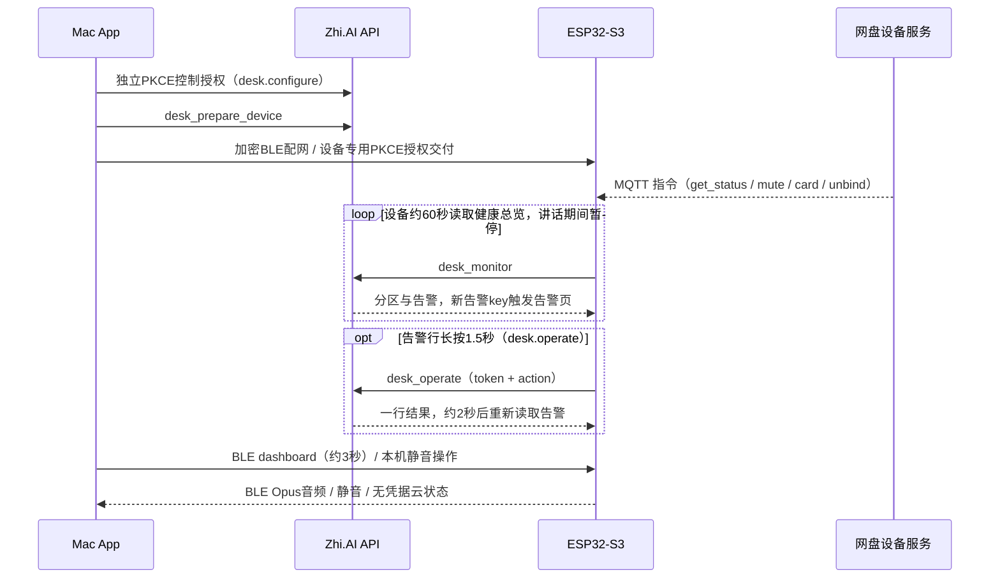

# YahaDesk 架构

ESP32-S3 固件与 Mac App 通过加密 BLE 传音频、静音、指标、配网和设备授权；设备直接以 Wi-Fi/HTTPS 连接云端。
Mac 只负责配网与设备授权交付，不拉取或确认设备指令。设备空闲界面是桌面工作台，契约见[桌面工作台需求](archive/requirements/desk-workbench-2026-11-05/README.md)；2026-11-05 删除了页面轮播。

## 模块与职责

| 模块 | 职责与边界 |
| --- | --- |
| 共用 `DeskProtocol`（`apps/shared`） | 音频分片、GATT载荷、配网载荷、PKCE和回调解析；无I/O |
| 共用 `DeskShared`（`apps/shared`） | `CloudClient`负责HTTPS/OAuth/MCP，`LoopbackReceiver`仅监听127.0.0.1的随机端口；网盘登录与文件、DMS、录音回放、AI 整理；macOS 与 iOS 都依赖 |
| Mac `DeskCore/Link` | `Uplink`串行队列维护BLE、Opus解码 |
| Mac `DeskCore/Audio` / `Input` / `Metrics` | Opus/BlackHole出口、讲话键、CPU/内存/键鼠和Mac电量；指标走BLE，不经云端 |
| Mac `YahaDesk/Services/CloudSync` | 控制授权生命周期、配网/设备授权交付；控制refresh token存钥匙串，设备token不留Mac |
| Mac `YahaDesk/Views` | 菜单栏入口、独立控制窗口、配网与设备授权 |
| 固件 `uplink` / `mic_state` / `audio` | BLE加密配对、GATT、统一静音、ES7210采集与Opus，云端不能开麦 |
| 固件 `cloud` | 独立任务运行Wi-Fi/HTTPS/OAuth/MCP、健康总览轮询、命令游标与通知缓存；BLE配网/授权写入经存储互斥锁提交NVS后才确认，网络请求只在后台任务执行 |
| 固件 `display.h` / `display_json.h` | 无I/O的工作台导航（点击、新告警跳转、空闲返回）、通知规则与 `desk_monitor` 解析，可用host C++行为测试 |
| 固件 `main` / `board_screen` / `board` | 优先合成配对/讲话，再合成工作台首页/总览/详情/告警/通知页；CST9220触摸经 esp_lvgl_port 输入，短按与告警行1.5秒长按只在LVGL线程记录、主循环取走，长按交给`cloud`单槽排队提交；LVGL渲染仍走既有屏幕线程 |
| API `domain/desk` / `dao/store` / `mcpingest` | 健康总览纯规则与阈值、只读聚合查询、按分区权限判定、scope工具边界；告警操作令牌签名与`desk_operate`单次认领审计（`desk_operation`），任务操作复用任务队列 |

## 数据与控制流

## 兼容、恢复与权限

- 原GATT UUID、音频与静音含义保留；dashboard同时接受旧10字节与新12字节。新能力用info的`cloud 1`和新特征判断；`display 1`在轮播删除后仍保留，因0.2.0 Mac以它判定配网与12字节dashboard；无 networks 特征的旧固件回到手动输入 Wi-Fi 名称。
- `desk.configure`不能调用`desk_feed`或`desk_monitor`。设备控制只走网盘设备服务，yahaops 不再下发命令。设备授权仍用本人专用公开应用，只登记`desk.sync`，活跃管理员另加`desk.operate`（设备只回传服务端签发的单次令牌，不能指定任务或参数）；两份授权、两套凭据存放边界分开。
- 0.2.0 固件仍调的`desk_pull`被API接受并恒返回空指令。通知按TTL独立过期，最多保留20条 agent 卡片（满了淘汰最旧的；0.4.2 起固件不再调用`desk_feed`）。健康总览超过3分钟未更新时清掉等级并提示过期。
- 重新授权建立新的设备会话，旧账号的消息与总览不能进入新会话；断电恢复也遵守同一边界。
- 配对和讲话优先；Mac断开仍可通过Wi-Fi展示内容，Mac指标过期显示未知。云端网络错误不能卡住音频采集和主屏幕循环。
- 发布先API、后Mac/固件；固件烧录和浏览器登录由用户授权/操作，构建通过不代表真机性能或实际授权通过。

验证入口与实际证据见[需求](archive/requirements/desk-workbench-2026-11-05/README.md)与[验收表](archive/requirements/desk-workbench-2026-11-05/acceptance.md)。
