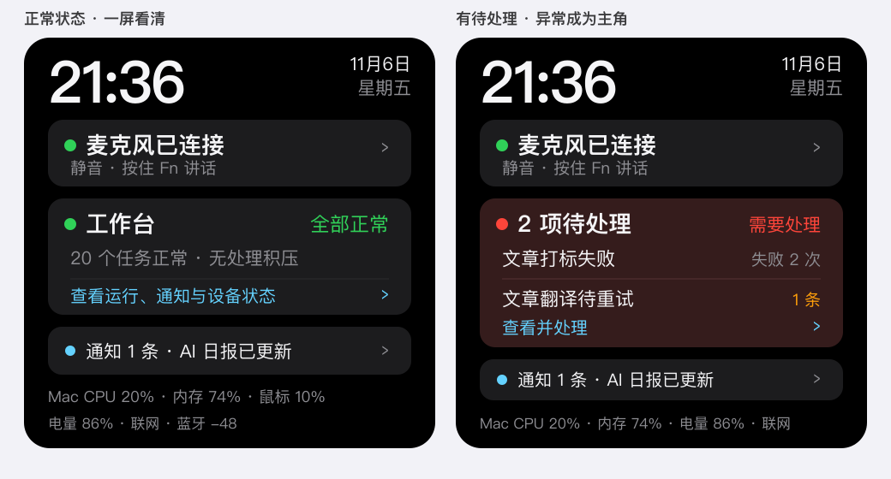
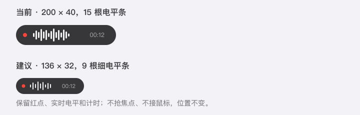
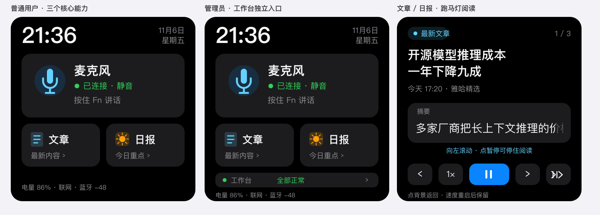

# 桌面待处理优先 UI 与轻量讲话浮层（2026-11-06）

## 首轮设计边界（已被后续实现授权替代）

用户最初要求先模拟并确认，再实现、烧录；首轮只提供视觉稿。用户确认后已继续实现固件、Mac 与 iOS，仍未烧录固件。

## 设计判断

- 当前首页四个 116px 圆环占据 252px 高度，Mac CPU/内存与外设电量成为主角，而真正需要处理的告警只有底部一行。
- 新首页保留时钟、麦克风连接与静音状态、通知；四环收成一行文字摘要。工作台正常时显示健康摘要，有异常时在同一张卡直接列出待处理事项，点击进现有告警页处理，不在首页增加长按手势。
- 讲话浮层从 200×40 缩到 136×32，15 根电平条减为 9 根；保留红点、计时、连接/离线状态、不抢焦点和不接鼠标的既有行为。

## 模拟稿

以上为 SVG 主机视觉模拟，不是 LVGL 真机渲染；确认后需补主机渲染、字库宽度、内存、触摸与真机验收。

## 首轮后续范围（现已完成实现）

1. 用户确认后实现固件与 Mac，并运行既有构建、测试和 change-audit；烧录仍需按本次授权执行。
2. iOS 按既有 `desk-app-release-2026-11-06` 批 2–3 实现设备配置与录音列表/播放，不做 iPhone 录音；开发版后来已安装到 Yaha17。

## 第二版：按用户能力分层（用户反馈后）

Mac 浮层方案保留。固件第一版仍有过多文字，且把工作台放在所有用户的主要路径上，不符合产品重点；第二版调整为：

- 普通用户首页只有麦克风、文章、日报三个图形化入口，不再展示 Mac 四环或管理员告警。
- 麦克风卡显示连接/静音和「按住 Fn 讲话」，不新增触摸屏开麦，保持硬件静音与隐私边界。
- 管理员首页保留相同内容，只在底部多出一条工作台入口及健康状态；管理操作仍进入现有工作台，不占普通用户首页。
- 文章与日报共用内容阅读页：来源与页码在顶部，标题最多两行，摘要在独立区域单行跑马灯；底部改为图标化上一篇、速度、播放/暂停、下一篇/结束，减少文字按钮。
- 播放/暂停是本次新增交互，速度沿用 NVS 持久化；点背景返回。普通内容卡与管理员告警使用不同页面，不混用长按确认。

第二版仍是视觉模拟。实现前需确认内容页标题/摘要的现有 `desk_feed` 数据边界，以及普通用户与管理员分区的权限返回；不能仅靠固件隐藏入口代替服务端授权。

## 实现进展（同日续做）

- 固件首页已按第二版落地：麦克风主卡、文章/日报入口、仅服务端返回管理员工作台数据时显示工作台入口；阅读页支持上一篇、速度循环、跑马灯暂停、下一篇与结束。
- Mac 讲话浮层由 200×40、15 根电平条收为 136×32、9 根电平条；不改变不抢焦点、不接收鼠标和按住讲话行为。
- iOS 工作归入 [Yaha Desk Mac 上架与 iOS App](../desk-app-release-2026-11-06/README.md)：产品名已纠正为 `Yaha Desk`，开发版已安装到 Yaha17；蓝牙、网盘和播放的人工验收仍未完成。
- 本地证据：`display_test.cpp`、JSON/DMS/并发/内存/字库检查通过；新增首页与阅读页文案已进入小号字体子集并由宽度测试覆盖。ESP-IDF 6.1 `idf.py build` 通过，最终本机构建 `yahadesk.bin` 为 `0x3cd0d0`，4 MiB 应用分区余 5%。该余量较早期记录低，烧录前必须复核最终配置与真机内存，不能据本地构建声称已烧录或已生效。
