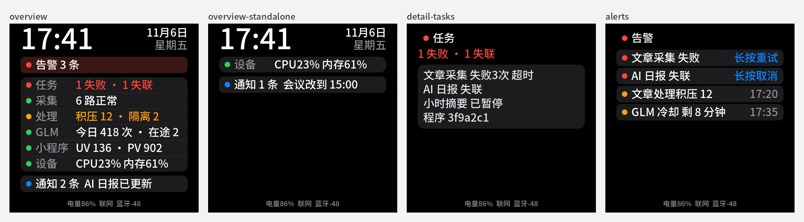
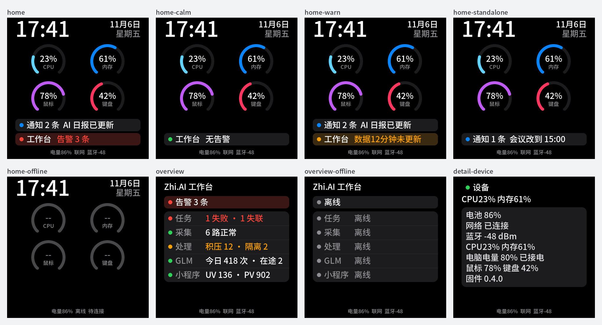

# 桌面固件首页改为雅哈麦克风样式（2026-11-06）

## 目标与授权

用户认为上一版[界面优化](../desk-ui-polish-2026-11-06/README.md)“还是缺点意思”，要求首页沿用雅哈麦克风（yahamic）的 Mac 风仪表盘，并把 Zhi.AI 相关的本人特有业务（任务、采集、处理、GLM、小程序与告警）单独分开。入口方式由用户在选项中确认为“首页底部一行入口”。Agent 负责实现、验证、审查与推送 `main`；烧录与发布不在本次授权内。

## 页面与导航

| 页面 | 内容 | 点击 |
| --- | --- | --- |
| 设备首页（默认） | 时钟 + 日期星期；2x2 四环 CPU/内存/鼠标/键盘（Mac 推送，10 s 无新包灰显 `--`）；通知条；连了 Zhi.AI 才有「工作台」入口行，文字为告警摘要并按等级着色；底部状态行 | 四环 → 设备详情；通知条 → 通知卡；入口行 → Zhi.AI 总览 |
| Zhi.AI 总览 | 页标题、告警条、五个云端分区（不再含设备行） | 分区 → 详情；告警条 → 告警页；背景 → 首页 |
| 详情 / 告警 / 通知 | 版式不变 | 云端详情与告警回总览；设备详情与通知回首页 |

闲置一分钟、通知被取完都回首页；新告警仍自动打开告警页。

## 实现边界

- `display.h`：新增 `Page::Home`（默认页）与 `kTapHub`、`kTapDevice`；`kRows` 改为 5 个云端分区，设备详情用 `Detail(kRows)`。
- `board::Screen` 新增 `meters[4]`；`main.cpp` 只在首页填四环与通知条，详情页按序号取云端分区或设备，指纹含四环，首页按秒走钟。
- 四环沿用 yahamic 的 270° `lv_arc`（无旋钮、圆头、10 px），配色取 macOS 深色系统色（青 `#64D2FF`、蓝 `#0A84FF`、紫 `#BF5AF2`、粉 `#FF375F`），与固件已有色板一致。
- 不新增字形与字库；不改 API、Mac、协议与 NVS；无数据迁移，回退即刷回旧固件。

## 验证

主机渲染（仓库字库 + LVGL 9.2.2，数据为示例）。改前（总览、未连 Zhi.AI 的总览、详情、告警）：

改后（首页有告警/正常/数据过期/未连 Zhi.AI/Mac 未连接，Zhi.AI 总览，设备详情）：

- `display_test.cpp`：`display behavior tests passed`，覆盖首页三个入口、总览返回首页、云端详情与告警回总览、设备详情与通知回首页、闲置回首页。
- `font_metrics_test.py`：通过，新增环内数值 96 px、环名、入口行 90/270 px 与总览标题宽度断言。
- `idf.py build`（ESP-IDF 6.1）：`Project build complete`，`yahadesk.bin` 0x2c1060，应用分区剩余 31%；`CONFIG_LV_USE_ARC=y`。
- `memory_layout_test.py`：通过。
- 主机 LVGL 池占用（64 位指针，偏大）：改前 67,784 B → 改后 73,224 B，+5.4 KB。设备是 32 位、`CONFIG_LV_MEM_SIZE_KILOBYTES=64`。
- 真机（2026-11-06，合入 codec 保温 `a21468ea` 后的 main `1328449a`，`idf.py app-flash`，未擦 NVS）：`screens ready LVGL total=59328 free=14000 max_used=45328`；内部 RAM `min=39828`；`boot_memory_test.py` 通过（Wi-Fi 静态 RX 缓冲 10 个），无 `E` 级日志。

未验证：真机观感、四环区与入口行的触摸命中（需人看屏、手点）。
