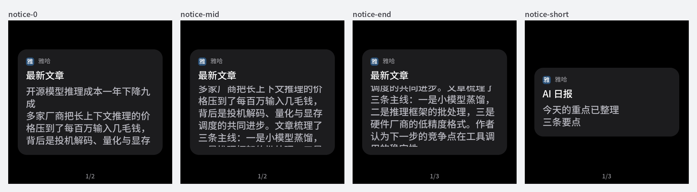
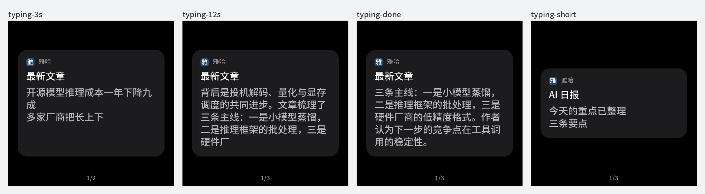
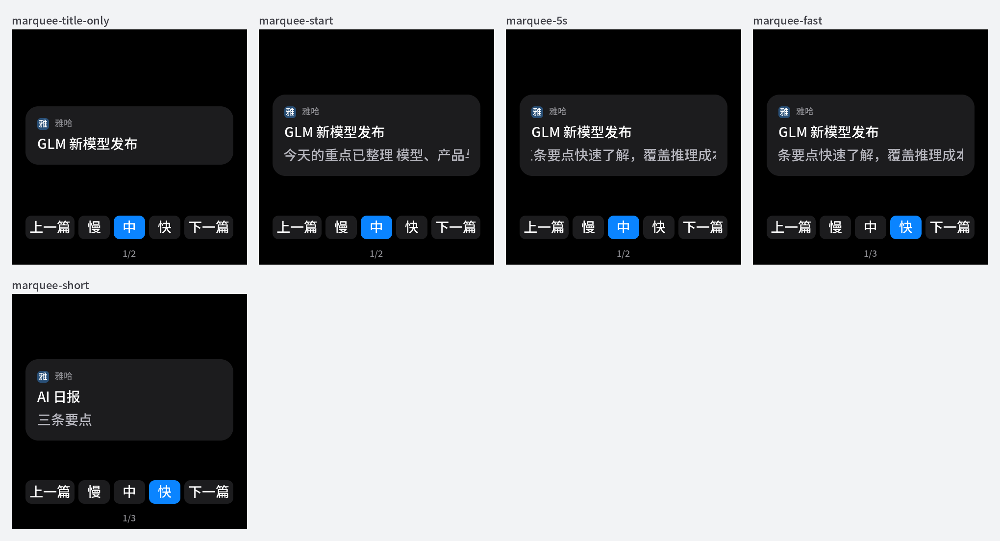
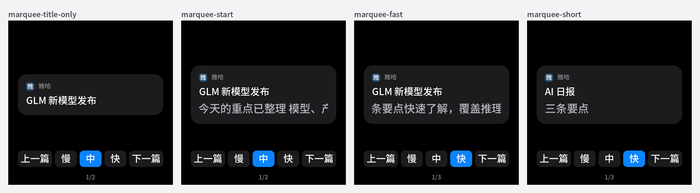

# 桌面通知卡正文自动滚动 → 字幕式逐字打出（2026-11-06）

## 目标与授权

用户反馈“最新文章”通知只显示五行、点一下就翻页或退出，看不到完整内容，希望滚动播放。Agent 负责实现、验证、审查与推送 `main`；烧录需单独授权。

## 行为（第一版：往返滚动，已被下节替换）

- 正文窗口仍最多五行，卡片高度不变；超出时窗口内自动滚动：停 2 s → 约 20 px/s（约 1.8 s 一行）滚到底 → 停 2 s → 滚回顶部，循环。
- 换卡或离开通知页后再进来从头滚；同一张卡因页码、状态行变化重画时不打断。
- 点击行为不变（翻下一条，最后一条回首页）；60 s 闲置回首页不变。
- 显示的是卡片正文的全部内容。文章卡由 API `desk.go` 拼成“标题 + 摘要”，`title+body` 上限 509 字节（BLE/卡片契约），不是文章全文；本次不改 API 与协议。

## 验证

主机渲染（仓库字库 + LVGL 9.2.2，示例长文章）：0 s、6 s、16 s 与短正文：

- 主机渲染断言：前 2 s 不动、6 s 已滚动、改页码重画不回顶、16 s 继续下移、短正文不滚、离开再进回顶、开机后首张只有标题的卡不留正文空块，`notice scroll ok`。
- `display_test.cpp`、`font_metrics_test.py`、`memory_layout_test.py` 通过；`idf.py build` 成功，应用分区剩余 31%。

未验证：真机滚动流畅度与阅读速度、动画期间的帧率与 CPU。

## 改为字幕式逐字打出（同日）

用户看过往返滚动后要求“打字直接从左往右，类似字幕”。替换为：

- 正文逐字打出（`kCardCharsPerSec = 8`），从左到右、按窗口宽度自动换行；窗口仍按整段定高（最多五行），打字过程中卡片不跳高。
- 超过五行时，窗口随最新一行整行上移，最新一行贴底；打完停 `kCardHoldMs = 5000` 后从头再打。五行内装得下的正文只打一遍、停住。
- 正文末尾的换行不计入（否则五行正文会被量成六行而循环重打）。
- 拉丁单词逐字打出时可能先排在行尾、超宽后整词跳到下一行（LVGL 按词换行）；中文按字换行不受影响，真机观感待看。
- 换卡、离开再进从头打；同卡重画不打断；离开通知页即停。点击与闲置行为不变。

主机渲染（3 s、12 s、打完、短正文）：

- 主机渲染断言（临时脚本 `render-typing.cpp`，与渲染图同为仓库外证据，未入库）：从空开始、重画不丢进度、超五行时窗口上移、16 s 打完全文、停 5 s 后重打、短正文打一遍停住、离开再进从头、首张仅标题卡不留空块，`notice typing ok`。
- 真机烧录（2026-11-06，`main` 741d36f5，`idf.py app-flash`，不擦 NVS）：开机 0 条 E 级日志；`screens ready LVGL free=13780 max_used=45524`，`WiFi init ready internal min=39828`，`boot_memory_test.py` 通过。打字速度与阅读观感待用户看真机。

## 改为一行跑马灯 + 底部按钮（同日）

用户看过字幕版后改为：屏幕中间一行文字跑马灯，底部可调速度，可点上一篇/下一篇。

- 正文的换行压成空格，整段放在一行，用 LVGL `LONG_SCROLL_CIRCULAR` 从右往左循环滚动；一行放得下就不动。
- 底部按钮：上一篇（第一篇时不动）/ 慢 中 快（70 / 112 / 168 px/s，约每秒 2.5 / 4 / 6 字）/ 下一篇（最后一篇时回首页）；点卡片其余处回首页。
- 速度档存 NVS（`desk` 命名空间 `speed`），重启沿用；中途换档从当前位置接着滚，同一张卡重画不打断，换卡和离开再进从头滚。
- 渲染图：
- 主机渲染断言（临时脚本 `render-marquee.cpp`，仓库外）：仅标题不留空块、正文一行、中档时长 = 一圈像素 / 112、重画不丢进度、换快档时长变且位置不跳、选中档高亮、换卡从头（含相邻两张正文相同）、短正文不动、离开再进从头，`notice marquee ok`。导航与速度键不离开卡片由 `display_test.cpp` 覆盖。
- 真机烧录（2026-11-06，`main` 82051f9c，`idf.py app-flash`，不擦 NVS）：开机 0 条 E 级日志；`screens ready LVGL free=11132 max_used=47872`（字幕版 13780 / 45524，五个按钮约多用 2.6 KB），`WiFi init ready internal min=39828` 不变，`boot_memory_test.py` 通过。滚动速度、按钮手感与速度档重启沿用待用户看真机。

## 跑马灯正文放大到 32 px（同日）

用户要求跑马灯文字大一些、最好能在 Mac App 上设置。正文可能是任意常用汉字，放大需要整套字库（3965 字）再生成一份，
而 4 MB 应用分区当时只剩约 1.3 MB；紧挨着的 `fac` 分区存出厂身份，不扩分区。用户选先固定加一档 32 px：

- 新字体 `font_zh_marquee`（`tools/make_fonts.sh` 生成，与 `font_zh_sub` 同字集，`font_metrics_test.py` 断言字集一致），只用于跑马灯正文；标题、按钮不变，行高 35 → 40 px。
- 速度按字数不变换算：慢 / 中 / 快 80 / 128 / 192 px/s（仍约每秒 2.5 / 4 / 6 字）。
- Mac App 设置字号未做：需要运行时字体渲染（独立字体分区 + tiny_ttf）和新的蓝牙指令，留待真机看过 32 px 后再定。
- 代价：应用分区剩余 31% → 5%（`0x3cb4b0` / `0x400000`，约 212 KB）；之后再加字库或大功能需先处理分区。
- 渲染图：
- 主机渲染断言（`render-marquee.cpp` 改用新字体与新速度）：`notice marquee ok`；审计 1 轮无 P1/P2，两处过时注释已改；`display_test.cpp`、`font_metrics_test.py`、`memory_layout_test.py` 通过，`idf.py build` 成功。

- 真机烧录（2026-11-06，`main` 9fd0c999，含告警行折行修复，`idf.py app-flash`，不擦 NVS）：开机 0 条 E 级日志；`screens ready LVGL free=10988 max_used=48016`（上版 11132 / 47872），`WiFi init ready internal min=39828` 不变，`boot_memory_test.py` 通过。

未验证：真机字号观感、动画帧率（字形变大，每帧绘制像素增多）。
