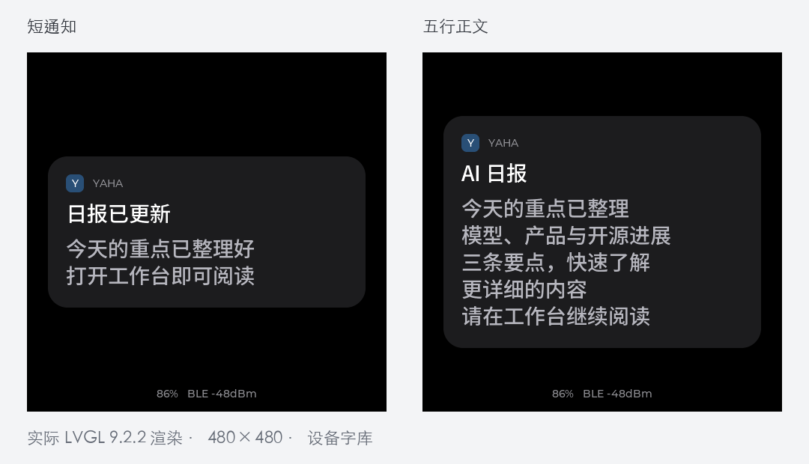
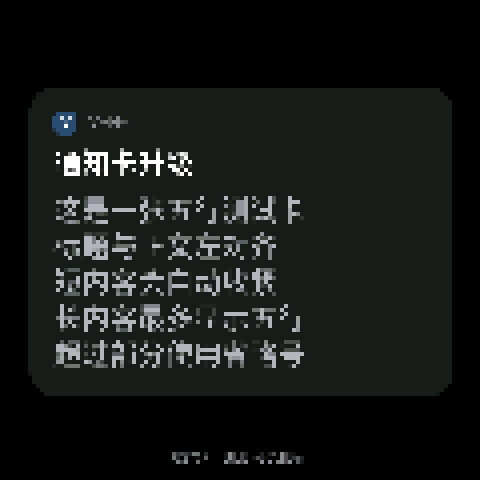
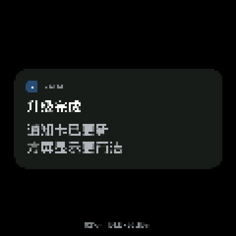

# 480×480 方屏通知卡（2026-11-03）

## 目标与授权

用户确认设备为 **480×480 方屏**，并认可深色圆角通知卡预览：424px 宽、两侧各 28px 留白、标题与正文左对齐、短内容自动收紧、正文最多五行。Codex 负责实现、验证、审查和提交推送。代码交付后，用户追加“需要烧录”，授权本次设备升级；已完成应用区写入和设备屏幕回传核对，详见下方烧录记录。

| 优先级 | 工作 | 负责人 | 检查点 | 验收标准 | 依赖 / 风险 |
| --- | --- | --- | --- | --- | --- |
| P0 | 核对历史、接口与字体，隔离工作区 | Codex | 产品代码修改前 | 确认只改变固件卡片绘制，保留旧协议 | 既有 card 链路 / 低 |
| P1 | 通知卡布局与文本高度 | Codex | 本轮交付前 | 卡面宽424px，标题一行，正文最多五行，长短替换能伸缩，空正文不留空块 | LVGL 9.2.2、现有字库 / 低 |
| P1 | 构建、实际 LVGL 渲染与独立审查 | Codex | 提交推送前 | 固件构建通过；长短中文、五行截断与标题卡通过渲染检查 | ESP-IDF 6.1 / 低 |
| P2 | 真机显示回归 | Codex / 用户 | 本次烧录后；人工项待用户确认 | 长短新卡回传已核对；物理屏幕观感、过期、清屏、讲话让位与松开恢复待验 | USB设备、本次烧录已授权 / 中 |

## 历史与兼容边界

- 历史依据：[桌面设备首版](../desk-device-2026-11-02/README.md)、[现行公开云端契约](../../../cloud-contract.md)、提交 `3ca87f1a` 的卡片实现。源码中“圆屏”是旧布局假设，本次以用户确认的方屏为准。
- 调用链：`desk_send_card` → `desk_command` → Mac `CloudSync` / `Uplink` → BLE card → `uplink::Card` → `compose` → `board::screens::draw`。只有最终卡片视图调整。
- 保留 BLE/MCP 字段、title+body ≤509字节、TTL从入队起算、清屏、配对和讲话优先级。复用现有28px中文字库与14px ASCII字体，不生成新字库、不加依赖。
- 电量和蓝牙信息沿用既有状态字符串，缩小字号置于卡片外底部；不解析展示字符串或新增协议字段。仪表盘、讲话与配对视图保持原有实现。
- 不需要 API、Web、Mac、数据库或运行配置更新，也不走后端生产发布脚本。设备升级只涉及固件；烧录授权前仅交付构建产物。回退可使用修改前的固件；无数据迁移。

## 实现与验收

- 用 LVGL flex 内容高度完成卡面伸缩；标签先用原文测量再限制为五行，避免 `LONG_DOT` 按上一张短卡高度提前截短原文。标题亮白、正文浅灰，卡面为 `#1C1C1E`，圆角26px、内边距24px。
- 字体行高35px，正文行间距1px；五行高度179px。超出用 `LV_LABEL_LONG_DOT` 省略，空正文隐藏对应标签。
- 官方依据：[LVGL 9.2 Label 文档](https://docs.lvgl.io/9.2/widgets/label.html#long-modes)，以及锁定版本9.2.2的 `lv_label.c`。使用复制文本的 `lv_label_set_text`，不向原地截断模式传只读静态缓冲。

下图为使用仓库字库的实际LVGL主机渲染，状态值为示例，并非设备拍摄：

| 编号 | 前置 / 操作 | 预期 |
| --- | --- | --- |
| DESK-CARD-01 | 推送一至两行中文 | 424px卡片居中，文字左对齐，正文清晰 |
| DESK-CARD-02 | 推送长中文，再替换为一行 | 卡片增长但正文最多五行，末尾省略；替换后卡片收缩且文字完整 |
| DESK-CARD-03 | 推送五行显式换行正文 | 五行完整显示，不误截断 |
| DESK-CARD-04 | 推送只有标题的卡片，再推正文卡片 | 标题卡紧凑；后续正文恢复显示 |
| DESK-CARD-05 | 卡片期间讲话、松开；随后等过期或清屏 | 讲话界面优先，松开恢复卡片；过期/清屏返回既有空闲界面（待真机） |

## 执行记录

- 基线：`53794c66`，独立分支 `codex/desk-notification-20261103`；不纳入根工作区已有的小程序验收结果与未跟踪二进制。
- CodeGraph 前置：当前独立worktree，v1.6.2，`complete`、`pendingRefs=0`、`pendingChanges=0`；源码确认 `make_card → init`，`board::screens::draw → board::draw`。
- 先验证旧实现：使用实际LVGL 9.2.2及仓库字库的主机渲染检查失败，输出 `FAIL: notification must use 424px width on a square 480px screen`，退出码1。
- 实现后实际LVGL渲染检查通过：`PASS: square card, grow/shrink, five-line UTF-8 truncation, empty-body replacement`，退出码0；覆盖长短中文替换、五行省略、空正文及再次恢复正文。主机检查只替代硬件接口，不替代LVGL和字库；不代表真机烧录或屏幕验收完成。
- `idf.py -C yahaops-desk/firmware build`：退出码0，`Project build complete`；应用大小 `0x1e6590` 字节，4MB分区剩余53%。首次激活SDK因非登录bash找不到Homebrew Python而退出，补充既有Homebrew路径后使用已安装ESP-IDF 6.1构建成功；未修改SDK或依赖版本。
- 固件不纳入后端 `deploy/verify-gates.sh`，按根项目约定使用本地ESP-IDF构建及实际LVGL渲染验证；不为静态视觉样式新增平行门禁或依赖。
- CodeGraph收尾：当前独立worktree，v1.6.2，`complete`、`pendingRefs=0`、`pendingChanges=0`；`set_card_body` 仅由卡片绘制分支调用。
- 独立审查：第1轮通过，无确定的P0/P1/P2问题，无必须精简项；独立核对调用链、LVGL文本截断源码、主机检查和实际渲染图。主机检查是本次验证证据，不作为仓库持续回归门禁。
- 应用二进制SHA-256：`e9fbfc9a78726ee76ffd69817a230de1644f4c128e75924eb167a165ba339f7a`。
- 代码交付阶段：代码合入 `main`（`349feee40cf3bdfc332444697e5b979118dd9c82`），保留固件构建产物；当时未烧录。后续追加授权与设备证据见下节，不能把构建和主机渲染通过当成设备已生效。

## 追加授权与烧录验收（2026-11-03）

- 用户明确要求“需要烧录”。目标为已配对设备 `yahadesk-XXXX`，USB 端口 `/dev/cu.usbmodemXXXX`，基础 MAC `xx:xx:xx:xx:xx:xx`；同机另一块 ESP32 未操作。
- 烧录前完整读取并备份 16MB Flash。备份只保存在本机 `~/Library/Application Support/YahaDesk/firmware-backups/20261103-notification-349feee4-6l04pvzt/`，文件权限为0600；包含配对数据，不入仓库。备份 SHA-256：`f13714a43e95dca3a4a18ad04d9a5bfc9562f5a788824528b90336b8b3716b1a`。
- 实际分区表与构建产物逐字节一致。使用 ESP-IDF 6.1 环境内 `python -m esptool --chip esp32s3 --port /dev/cu.usbmodemXXXX --baud 460800 write-flash --flash-mode keep --flash-freq keep --flash-size keep 0x10000 <产物目录>/yahadesk.bin`，仅写应用区，未改 NVS、bootloader、分区表。
- 写入退出码0，真实输出：`Wrote 1992080 bytes ... at 0x00010000 in 6.7 seconds`、`Hash of data verified.`、`Hard resetting via RTS pin...`。应用 SHA-256 与上文构建记录相同。
- 新程序启动日志：`Project name: yahadesk`、`Compile time: Nov 3 2026 21:05:32`、`ELF file SHA256: 61f19741b...`；产物 ELF 完整摘要为 `61f19741b830ac21e9cfc0667e56c397e857db133a84522546e2e692289dd463`。固件版本按既有契约仍为 `0.1.0`，以编译时间及 ELF 摘要区分此次构建。
- Mac 自动恢复原有加密 BLE 连接，无需重新配对。推送五行卡 `id=6` 和两行短卡 `id=7`，两次均由 Mac 送往设备，分别完整回传120行屏幕像素；最后云端返回 `synced=true`、`online=true`、`connected=true`、`pending=0`，静音状态保持。
- 首次截屏曾得到空闲仪表盘。复核发现：打开 USB 串口产生 `rst:0x15 (USB_UART_CHIP_RESET)`，会重启并丢失内存中的卡片。改为先开串口、等 Mac 重连、再送卡、保持串口采集后，两次卡片回传正常；未为此修改固件或再次烧录。
- 以下是设备现有 SCR 接口每4像素采样所得120×120图像，放大至480×480，**用于核对布局，不代表面板实际文字清晰度**。已核对五行排布和短卡收缩；物理屏幕观感仍需用户确认。

| 五行正文 | 两行短卡 |
| --- | --- |
|  |  |

- 本次未验证：升级后的讲话让位与恢复、TTL到期时序、清屏端到端效果、运行RAM水位；不将此前测试或主机渲染当成这些项目的真机验收。
- 本次代码已完成 ESP-IDF 构建和独立审查；此追加提交只保存烧录证据文档及采样图片，以 `git diff --check` 和图片来源/尺寸核对验证，不重跑未变化的 API、Web、小程序门禁，也不执行后端生产发布脚本。
