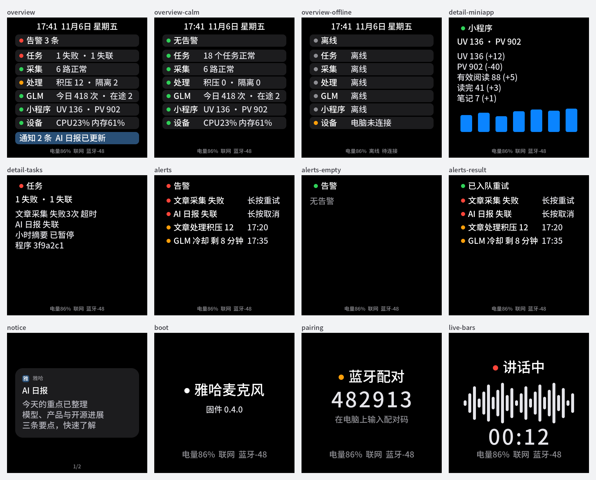
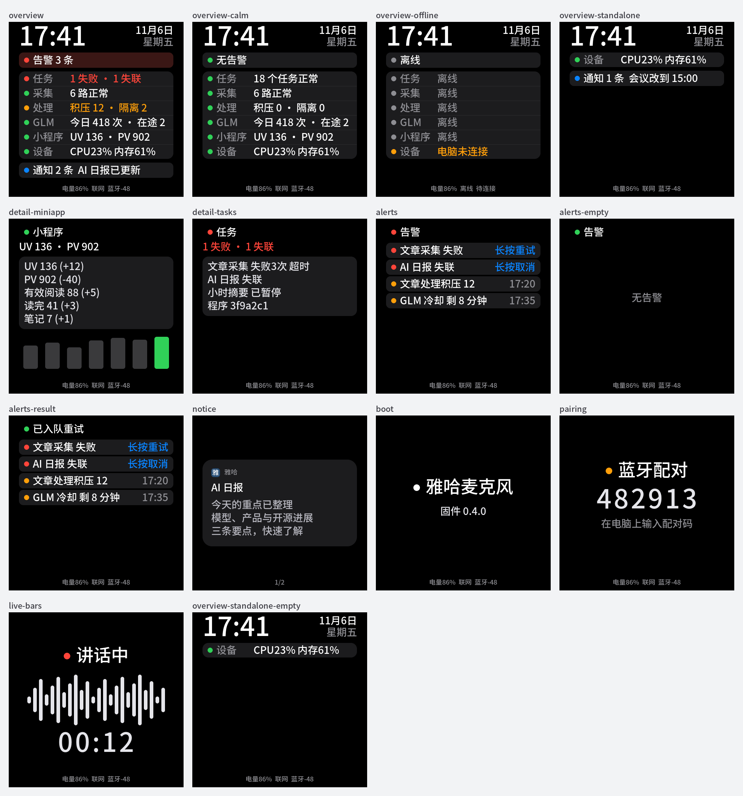

# 桌面固件界面视觉优化（2026-11-06）

## 目标与授权

用户要求结合现有固件界面做得更好看，以展示层为主，先按 oil-ui 设计再实现；并提醒发布时任务管理与 Zhi.AI 连通部分是本人特有功能，普通用户不应被这些内容打扰。Agent 负责设计、实现、验证、审查与推送 `main`；烧录与发布不在本次授权内。

## oil-ui 评审（review 模式，按项目自身设计语言）

假设：480×480 方形 AMOLED，桌边一臂距离扫视；主要任务是“现在几点、有没有要处理的事”。

| 级别 | 发现（证据：`before.png`） | 处理 |
| --- | --- | --- |
| P0 | 未连 Zhi.AI 的设备总览满屏五行“未授权”和一条“未授权”告警条，普通用户看到的全是不属于他的功能 | 未授权时只留设备行，不显示告警条；列表与通知条上移 |
| P1 | 时钟与 7 个灰色胶囊同字号同权重，3 秒内找不到重点 | 时钟改 72px 数字字体，日期星期右对齐成两行 |
| P1 | 异常只靠 14px 圆点区分，扫视时“积压 12”和“6 路正常”一样白 | 摘要文字随等级着色（警告橙、错误红、不可用灰），分区名降为灰色 |
| P1 | 有告警时告警条与正常行同底色 | 告警条按等级染暗红/暗橙 |
| P1 | 告警行只是平铺文字，可长按的行与只读行没有区别 | 告警行改实色卡片；“长按…”提示蓝字右对齐，时间灰字右对齐 |
| P2 | 通知条 `#294F76` 实色块与整套中性色冲突 | 改为与其它行同底色的蓝点行 |
| P2 | 详情趋势是 7 根亮蓝柱，看不出哪根是今天 | 历史柱深灰，今天一根用分区等级色；详情行放进面板 |
| P2 | 告警空状态是左上角一行灰字 | 空状态居中 |
| P2 | 状态屏底部状态行 28px、工作台 18px，同一信息两种样式 | 全部屏统一 18px 底部状态行 |

沿用既有 token：macOS 深色系统色、`#1C1C1E` 面板、28px 正文、16px 列表圆角（卡片仍 26px）；只新增分隔线 `#2C2C2E`、历史柱 `#3A3A3C` 两个中性色。通知卡观感已达标，未改。

## 实现边界

- `board_screen.cpp` 只改布局与配色；`board::Screen`、`draw`/`take_tap`/`take_hold` 契约和点击目标编号不变。
- `main.cpp compose`：`cloud_view.authorized` 为假时不生成五个云端分区、告警条为空（空标题即隐藏）。行与详情页都从同一个 `sections` 取，点击序号仍一致。去掉不再显示的“未授权”文案。
- 已授权但非管理员的账号仍按 `desk_monitor` 返回显示灰色“任务诊断仅限管理员”等原因行，不在固件里解析原因字符串。
- 不新增字形和字库：时钟用既有 `font_clock_num`（数字+冒号），未校时显示“等待校时”。不改 API、Mac、协议与 NVS；无数据迁移，回退即刷回旧固件。

## 验证

下图为使用仓库字库与 LVGL 9.2.2 的主机渲染（数据为示例，非设备拍摄）。改前：

改后（新增未连 Zhi.AI 的总览两种状态）：

- `python3 yahaops-desk/firmware/tests/font_metrics_test.py`：通过，新增时钟 240px、日期/星期/“等待校时” 184px 宽度断言。
- `display_test.cpp`：`display behavior tests passed`。
- `idf.py build`（ESP-IDF 6.1）：`Project build complete`，`yahadesk.bin` 0x2c0ca0，应用分区剩余 31%。
- `memory_layout_test.py`：通过。
- 独立审查（1 轮）：详情面板原用 `LV_SIZE_CONTENT`，从无明细切到单行明细时停在 20 px、文字被裁一半（隐藏子项不计入内容尺寸，单行高度未变不触发重算）；已改为按明细高度显式定高。主机渲染加“多行→空→单行”回归，修复前失败（`panel h=20`），修复后通过（`h=55`）。另按审查删掉三处与 LVGL 自带判断重复的包装。
- 主机渲染 LVGL 池占用（64 位指针，偏大）：改前 64,088 B → 改后 67,792 B，+3.7 KB；设备为 32 位、64 KB PSRAM 池，实际水位需真机 `screens ready` 日志确认。

未验证：真机屏幕观感、触摸命中、运行时 LVGL 池与内部 RAM 水位。代码已推送 `main`，未烧录。
