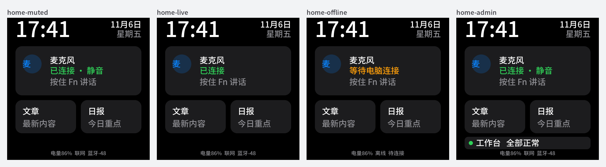
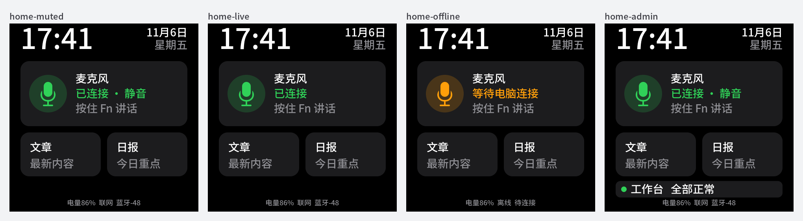

# 桌面首页麦克风卡改用话筒图标

## 目标

用户 2026-11-07 反馈首页麦克风展示太丑。原卡片左侧是蓝色圆底里一个「麦」字，偏小、偏左，颜色与下方连接状态不一致。

## 改动

- `board_screen.cpp`：圆形徽章放大到 96 px 并垂直居中；里面用四个色块拼出话筒（头、U 形托架、立杆、底座）。
- 徽章和话筒随连接状态着色：已连接绿色，等待电脑连接橙色，与状态文字同色。
- 文字列右移到 x=140，宽 260 px；`font_metrics_test.py` 按 260 px 检查四种状态文案。
- 不新增字形、图片或字库；不改协议、Mac 与 NVS。

## 验证

主机渲染（仓库字库 + LVGL，示例数据）。改前：

改后（静音、送声、未连接、管理员）：

- `display_test.cpp`、`font_metrics_test.py`、`memory_layout_test.py` 通过。
- 主机 LVGL 池占用 76,000 B → 77,048 B（+1 KB，64 位指针偏大）。
- `idf.py build`（ESP-IDF 6.1）通过，镜像 3,985,947 字节。

## 未验证

真机观感与卡片触摸命中：需烧录后人看屏、手点。

## 烧录记录

- 2026-11-07 用户授权烧录。从 `main` 提交 `2bae9e29` 构建，写入 `yahadesk-222a` 的 bootloader、分区表与应用，SHA 校验通过；未擦 NVS。
- 启动：固件 0.3.0，未重新配对即连回 Mac，`wifi:pm start, type: 1`；`screens ready LVGL total=59068 free=11528 max_used=47540`，无 `E` 级日志。
- 烧录后 Wi-Fi 已连上时 30 s 压测：498 帧收发一致，跳号 0，欠载 0，缓冲最低 99.8 ms。
